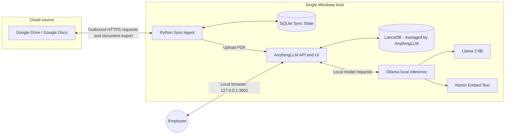
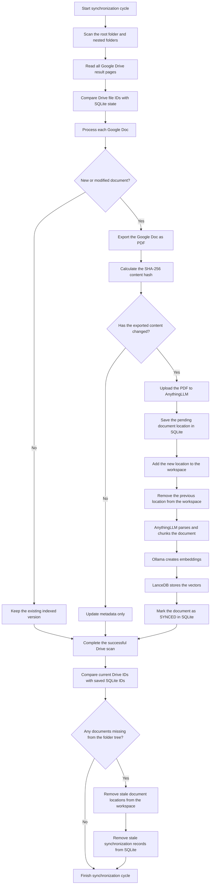
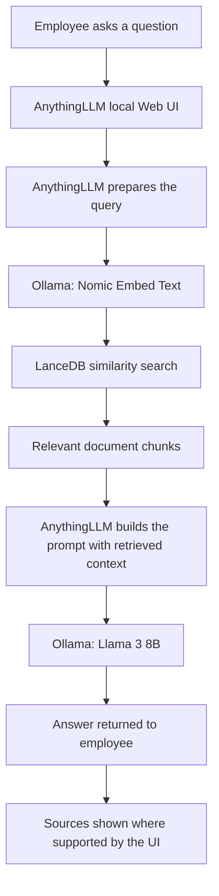

# Secure Local RAG — Google Drive to AnythingLLM and Ollama

> **Local AI processing and inference with outbound Google Drive synchronization.**
>
> A single-user, Windows-first pilot that synchronizes Google Docs from one Google Drive folder, indexes them in AnythingLLM, and answers questions with locally running Ollama models.

  

> **Arabic step-by-step installation guide:** [SETUP.md](SETUP.md)

## 1. Project overview

This project provides a private Retrieval-Augmented Generation (RAG) assistant for company documents. It connects to Google Drive using a read-only service account, exports Google Docs to PDF, and sends those PDFs to a local AnythingLLM instance. AnythingLLM manages document processing, chunking, retrieval, workspace membership, and the local LanceDB vector store. Ollama runs the embedding and chat models on the host computer.

The goal of V1 is deliberately limited: **one employee, one Windows computer, one configured Google Drive folder tree, and Google Docs only**. The current V2 Sync Agent implements recursive folder discovery, pagination, SQLite state, SHA-256 change verification, pending-embedding recovery, and workspace-level deletion reconciliation. The system is designed to be useful without introducing infrastructure that is not yet needed.

### Important privacy boundary

This is **not an air-gapped system** and should not be described as 100% on-premise end-to-end:

- Google Drive remains the cloud source of truth.
- The local Python Sync Agent initiates outbound HTTPS requests to Google's APIs to read file metadata and export document content.
- Document ingestion, embeddings, vector storage, retrieval, and LLM inference are intended to run locally on the host computer.
- No hosted LLM or hosted embedding provider should be configured.
- Initial installation, model downloads, software updates, and Google Drive synchronization require internet access.

A precise description is: **local/on-premise AI processing and inference, with outbound Google Drive synchronization**.

## 2. Agreed V1 scope

| Area | V1 decision |
|---|---|
| Users | One employee using the same computer that hosts the system |
| Operating system | Windows 10/11 is the primary documented environment; Linux is possible with path/network adjustments |
| Data source | Google Docs only |
| Drive location | One configured Google Drive folder, including nested folders |
| File processing | Export Google Docs to PDF, then upload to AnythingLLM |
| Synchronization | Scan every 15 minutes by default |
| Change detection | Drive `modifiedTime`, followed by a SHA-256 hash after export |
| Sync state | Local SQLite database |
| RAG application | AnythingLLM in Docker |
| Vector store | LanceDB managed by AnythingLLM |
| Local inference | Ollama on the host computer |
| Initial chat model | Llama 3 8B family (`llama3:8b`) |
| Initial embedding model | `nomic-embed-text` |
| Target GPU | NVIDIA RTX 3070 8 GB VRAM or equivalent; actual performance must be measured |
| User permissions | No per-user or per-document permission model in V1; all in-scope documents are visible to the single user |
| Network exposure | AnythingLLM bound to `127.0.0.1`; no LAN access in V1 |

### Explicitly out of scope for V1

- Multiple employees connecting to one shared host.
- A dedicated always-on company workstation or server.
- LAN access, remote access, reverse proxy, or TLS termination.
- Per-user or per-document authorization.
- Google Sheets, Google Slides, DOCX, uploaded PDFs, or other file types.
- Event-driven synchronization, webhooks, or Google Drive Changes API optimization.
- Redis, Kafka, PostgreSQL, Kubernetes, or other additional infrastructure.
- Reranking models and advanced retrieval pipelines.

These may be considered after the single-user pilot proves useful.

## 3. System architecture

### 3.1 High-level architecture



The arrows from Google Drive represent requests initiated by the local Sync Agent. Google Drive does not initiate an inbound connection to the computer.

### 3.2 Synchronization / ingestion flow



### 3.3 Question / retrieval flow



The embedding model is used both when indexing document chunks and when embedding a user's question. The chat model generates the natural-language answer using the retrieved context. **The embedding model does not generate the answer.**

## 4. Components and responsibilities

| Component | Responsibility | Runs where |
|---|---|---|
| Google Drive API | Read file metadata and export Google Docs | Google Cloud |
| Python Sync Agent | Traverse the folder tree, detect changes, export PDFs, call AnythingLLM, reconcile deletions | Host computer |
| SQLite | Persist file IDs, hashes, AnythingLLM locations, sync status, and errors | Host computer |
| AnythingLLM | UI, API, document parsing, chunking, workspace management, retrieval orchestration | Docker container |
| LanceDB | Store and retrieve vector embeddings | Managed locally by AnythingLLM |
| Ollama | Serve local embedding and chat models | Host computer |
| Llama 3 8B | Generate answers | Ollama on host |
| Nomic Embed Text | Convert document chunks and questions into embeddings | Ollama on host |

LanceDB is shown as a separate logical box in the architecture, but V1 uses the vector store managed by AnythingLLM. It should not be deployed as a separate service.

## 5. Repository layout

The GitHub repository can contain this single self-contained `README.markdown` plus the runtime files below. The full source code and configuration templates are embedded in this README for reference and copy/paste use.

```text
secure-local-rag/
├── README.markdown           # This complete project document
├── SETUP.md                  # Arabic step-by-step installation guide
├── sync_agent.py             # Python synchronization daemon (code below)
├── requirements.txt          # Python dependencies (below)
├── .env.example              # Configuration template (below)
├── .gitignore                # Files that must not be committed (below)
├── credentials.json          # Google service-account key (local only; never commit)
├── .env                      # Local secrets and settings (local only; never commit)
├── data/
│   └── sync_state.sqlite3    # Created automatically
├── logs/
│   └── sync_agent.log        # Created automatically
└── tmp/                      # Temporary exported PDFs; cleaned after upload
```

## 6. Prerequisites

- Windows 10/11 (primary instructions below) or a supported Linux host.
- NVIDIA GPU suitable for local model inference. The initial target is RTX 3070 8 GB VRAM.
- Current NVIDIA driver if using an NVIDIA GPU.
- Docker Desktop with its Linux container engine enabled.
- Ollama installed on the host OS.
- Python 3.10 or later.
- Internet access for initial setup, model downloads, and Google Drive synchronization.
- A Google Cloud project with the Google Drive API enabled.
- A Google service account with Viewer access to the target Drive folder.
- An AnythingLLM API key and a configured workspace.

### Hardware notes

An 8 GB GPU may run a quantized 8B model, but usable VRAM depends on quantization, context length, Ollama version, other GPU workloads, and how many model layers are offloaded. Measure real memory use and response latency; do not assume the complete model will always fit in VRAM. Embedding and chat workloads can compete for GPU memory.

Useful checks:

```powershell
nvidia-smi
ollama ps
```

## 7. Installation and configuration

### 7.1 Install Ollama and pull the models

Install Ollama from its official website, then run:

```powershell
ollama pull nomic-embed-text
ollama pull llama3:8b
ollama list
ollama ps
```

The `nomic-embed-text` model is an embedding-only model. It cannot be used as the chat model. The current Ollama model listing describes `nomic-embed-text` with a 2K-token context window, so configure and test AnythingLLM chunk sizes accordingly; do not assume oversized chunks will be embedded without truncation or errors. `llama3:8b` is the initial chat model selection; test the exact model tag and quantization available in your Ollama installation. See the [Ollama model page](https://ollama.com/library/nomic-embed-text).

### 7.2 Start AnythingLLM with Docker

Create the persistent storage directory:

```powershell
New-Item -ItemType Directory -Force C:\anythingllm_data | Out-Null
New-Item -ItemType File -Force C:\anythingllm_data\.env | Out-Null
```

Pull the official image:

```powershell
docker pull mintplexlabs/anythingllm:latest
```

Start the container:

```powershell
docker run -d --name anythingllm --restart unless-stopped `
  -p 127.0.0.1:3001:3001 `
  --cap-add SYS_ADMIN `
  -v C:\anythingllm_data:/app/server/storage `
  -v C:\anythingllm_data\.env:/app/server/.env `
  -e STORAGE_DIR=/app/server/storage `
  mintplexlabs/anythingllm:latest
```

**Security note about `SYS_ADMIN`:** the upstream AnythingLLM Docker instructions include this capability in their standard run example. It is broad, so treat it as a deliberate exception rather than a harmless default. Keep the documented command for the first compatibility test; then, on a separate test run, try removing `--cap-add SYS_ADMIN` and verify startup, document upload, PDF parsing, embedding, and restart persistence. If the feature set works without it, keep the reduced-privilege configuration. Do not remove it from a live instance without testing. Pin the exact image version or digest that passes your tests instead of relying indefinitely on the mutable `latest` tag.

**Version security check (important):** do not deploy AnythingLLM **v1.16.1**. An upstream security advisory published on September 21, 2026 identifies a path-traversal issue in that release and lists patched versions as newer than `1.16.1`. The advisory describes exploit preconditions involving multi-user mode, a manager/admin account, and live-file-sync; V1 is configured for single-user local use, but the affected release should still be avoided. Use a patched release newer than `1.16.1`, verify the actual image version, and record the version/digest in your deployment notes. See [GHSA-3f4c-xj8r-h4cr](https://github.com/Mintplex-Labs/anything-llm/security/advisories/GHSA-3f4c-xj8r-h4cr).

The host port is deliberately bound to `127.0.0.1`. This means the UI is intended to be reachable only from the same computer in V1. Do not replace this with `-p 3001:3001` unless you deliberately redesign and secure network access.

Open:

```text
http://localhost:3001
```

Complete the initial setup:

1. Configure the instance password / single-user login.
2. Keep the instance in single-user mode for V1; do not enable multi-user mode.
3. Create a workspace, for example `company-documents`.
4. Configure the chat provider as Ollama.
5. Configure the embedding provider as Ollama.
6. Select `llama3:8b` as the chat model.
7. Select `nomic-embed-text` as the embedding model.
8. Generate an AnythingLLM API key and store it in the local `.env` file described below.

#### 7.2.1 Ollama connection from Docker

AnythingLLM runs inside a Docker container, while Ollama runs directly on Windows. From inside the container, `localhost` refers to the container itself, not the Windows host.

In the Ollama provider settings inside AnythingLLM, use:

```text
http://host.docker.internal:11434
```

Do not use `http://localhost:11434` from inside the AnythingLLM container. If the connection fails, check that Ollama is running and reachable from Docker. Do not expose the Ollama port to the wider LAN just to make the connection work; restrict host firewall access to the required local/Docker path.

### 7.3 Configure Google Drive API access

1. Open the [Google Cloud Console](https://console.cloud.google.com/).
2. Create or select a Google Cloud project.
3. Enable the [Google Drive API](https://console.cloud.google.com/apis/library/drive.googleapis.com).
4. Create a service account.
5. Create and download a JSON key for that service account.
6. Copy the service-account email address.
7. In Google Drive, share the target root folder with that service-account email and grant **Viewer** access.
8. Copy the folder ID from the URL of the target Drive folder.
9. Place the downloaded JSON key beside `sync_agent.py` and name it `credentials.json`.

The script uses this read-only OAuth scope:

```text
https://www.googleapis.com/auth/drive.readonly
```

The service account must be able to view the root folder and all nested folders and Google Docs. For a shared drive, ensure the service account has the appropriate membership/access. Domain-wide delegation is not required for the simple shared-folder arrangement described here.

**Protect the service-account key.** It grants access to the files shared with that account. Never commit `credentials.json` to GitHub or paste its contents into a chat, issue, or log.

### 7.4 Configure the Python project

Create and activate a virtual environment from the project directory:

```powershell
py -3 -m venv .venv
.\.venv\Scripts\Activate.ps1
```

Install dependencies:

```powershell
pip install -r requirements.txt
```

Create your local environment file:

```powershell
Copy-Item .env.example .env
notepad .env
```

Set the following values in `.env`:

```dotenv
# Google Drive
GOOGLE_CREDENTIALS_FILE=credentials.json
DRIVE_FOLDER_ID=PASTE_GOOGLE_DRIVE_FOLDER_ID_HERE

# AnythingLLM API reachable from the Windows host
ANYTHINGLLM_BASE_URL=http://127.0.0.1:3001/api/v1
ANYTHINGLLM_API_KEY=PASTE_ANYTHINGLLM_API_KEY_HERE
WORKSPACE_SLUG=company-documents

# Sync interval
CHECK_INTERVAL_MINUTES=15

# Local state, logs, and temporary export directory
STATE_DB_PATH=./data/sync_state.sqlite3
LOG_PATH=./logs/sync_agent.log
TEMP_DIR=./tmp
```

`WORKSPACE_SLUG` is the workspace slug, not necessarily the display name. Confirm the slug in AnythingLLM or its API documentation. The Python agent runs on the Windows host, so its AnythingLLM base URL is `http://127.0.0.1:3001/api/v1`.

### 7.5 Run the Sync Agent

Start the agent:

```powershell
python sync_agent.py
```

The agent performs an initial synchronization immediately, then repeats after the configured interval. The default is 15 minutes.

Stop it with `Ctrl+C`. During the pilot, run it in a visible terminal so failures can be observed. A Windows Task Scheduler task or Windows service can be considered later if unattended operation is required.

## 8. Configuration templates

### 8.1 `requirements.txt`

```text
google-api-python-client>=2.150.0
google-auth>=2.35.0
requests>=2.32.0
python-dotenv>=1.0.1
```

### 8.2 `.env.example`

```dotenv
# Google Drive: share the configured folder with the service account.
GOOGLE_CREDENTIALS_FILE=credentials.json
DRIVE_FOLDER_ID=PASTE_GOOGLE_DRIVE_FOLDER_ID_HERE

# AnythingLLM is exposed on the Windows host at port 3001.
ANYTHINGLLM_BASE_URL=http://127.0.0.1:3001/api/v1
ANYTHINGLLM_API_KEY=PASTE_ANYTHINGLLM_API_KEY_HERE
WORKSPACE_SLUG=company-documents

# How often the agent scans folder metadata.
CHECK_INTERVAL_MINUTES=15

# Local state and logs.
STATE_DB_PATH=./data/sync_state.sqlite3
LOG_PATH=./logs/sync_agent.log
TEMP_DIR=./tmp
```

### 8.3 `.gitignore`

```gitignore
.env
credentials.json
data/
logs/
tmp/
__pycache__/
*.py[cod]
.venv/
```

## 9. Python Sync Agent — complete source code

Save the following code as `sync_agent.py` in the project directory.

```python
"""Google Drive -> AnythingLLM local document synchronizer.

Scope of this first production-minded version:
- Google Docs files only (exported to PDF)
- One configured Drive folder, including nested folders
- Metadata scan every N minutes; download/embed only changed content
- SQLite state, retries for transient API failures, deletion handling, logging

The script does not send document content to a hosted LLM. Google Drive remains
an external cloud source and is contacted over HTTPS for synchronization.
"""

from __future__ import annotations

import hashlib
import json
import logging
import os
import sqlite3
import tempfile
import time
from collections import deque
from contextlib import contextmanager
from datetime import datetime, timezone
from pathlib import Path
from typing import Any
from urllib.parse import quote

import requests
from dotenv import load_dotenv


BASE_DIR = Path(__file__).resolve().parent
load_dotenv(BASE_DIR / ".env")

# ----------------------------- Configuration -----------------------------
_credentials_path = Path(
    os.getenv("GOOGLE_CREDENTIALS_FILE", str(BASE_DIR / "credentials.json"))
)
GOOGLE_CREDENTIALS_FILE = (
    _credentials_path if _credentials_path.is_absolute() else (BASE_DIR / _credentials_path).resolve()
)
DRIVE_FOLDER_ID = os.getenv("DRIVE_FOLDER_ID", "").strip()

ANYTHINGLLM_BASE_URL = os.getenv(
    "ANYTHINGLLM_BASE_URL", "http://127.0.0.1:3001/api/v1"
).rstrip("/")
ANYTHINGLLM_API_KEY = os.getenv("ANYTHINGLLM_API_KEY", "").strip()
WORKSPACE_SLUG = os.getenv("WORKSPACE_SLUG", "").strip()

CHECK_INTERVAL_MINUTES = int(os.getenv("CHECK_INTERVAL_MINUTES", "15"))
def project_path_from_env(name: str, default: Path) -> Path:
    raw = Path(os.getenv(name, str(default)))
    return raw if raw.is_absolute() else (BASE_DIR / raw).resolve()


DB_PATH = project_path_from_env("STATE_DB_PATH", BASE_DIR / "data" / "sync_state.sqlite3")
LOG_PATH = project_path_from_env("LOG_PATH", BASE_DIR / "logs" / "sync_agent.log")
TEMP_DIR = project_path_from_env("TEMP_DIR", BASE_DIR / "tmp")

GOOGLE_DOC_MIME = "application/vnd.google-apps.document"
GOOGLE_FOLDER_MIME = "application/vnd.google-apps.folder"
DRIVE_READONLY_SCOPE = ["https://www.googleapis.com/auth/drive.readonly"]
TRANSIENT_HTTP_STATUSES = {429, 500, 502, 503, 504}
# -------------------------------------------------------------------------


def configure_logging() -> None:
    LOG_PATH.parent.mkdir(parents=True, exist_ok=True)
    logging.basicConfig(
        level=logging.INFO,
        format="%(asctime)s | %(levelname)s | %(message)s",
        handlers=[logging.FileHandler(LOG_PATH, encoding="utf-8"), logging.StreamHandler()],
    )


def validate_config() -> None:
    missing = []
    if not DRIVE_FOLDER_ID:
        missing.append("DRIVE_FOLDER_ID")
    if not ANYTHINGLLM_API_KEY:
        missing.append("ANYTHINGLLM_API_KEY")
    if not WORKSPACE_SLUG:
        missing.append("WORKSPACE_SLUG")
    if missing:
        raise RuntimeError("Missing .env settings: " + ", ".join(missing))
    if not GOOGLE_CREDENTIALS_FILE.is_file():
        raise FileNotFoundError(
            f"Google credentials file not found: {GOOGLE_CREDENTIALS_FILE}"
        )
    if CHECK_INTERVAL_MINUTES < 1:
        raise ValueError("CHECK_INTERVAL_MINUTES must be at least 1")


def utc_now() -> str:
    return datetime.now(timezone.utc).isoformat(timespec="seconds")


# ------------------------------ SQLite state ------------------------------
class SyncDatabase:
    def __init__(self, path: Path):
        path.parent.mkdir(parents=True, exist_ok=True)
        self.path = path
        self._initialize()

    def connect(self) -> sqlite3.Connection:
        conn = sqlite3.connect(self.path, timeout=30)
        conn.row_factory = sqlite3.Row
        conn.execute("PRAGMA journal_mode=WAL")
        conn.execute("PRAGMA foreign_keys=ON")
        return conn

    @contextmanager
    def connection(self):
        # sqlite3's connection context manager commits/rolls back but does not
        # close the connection, so close it explicitly for this long-running daemon.
        conn = self.connect()
        try:
            with conn:
                yield conn
        finally:
            conn.close()

    def _initialize(self) -> None:
        with self.connection() as conn:
            conn.execute(
                """
                CREATE TABLE IF NOT EXISTS documents (
                    file_id TEXT PRIMARY KEY,
                    name TEXT NOT NULL,
                    mime_type TEXT NOT NULL,
                    modified_time TEXT,
                    sha256 TEXT,
                    anythingllm_location TEXT,
                    pending_location TEXT,
                    pending_sha256 TEXT,
                    pending_modified_time TEXT,
                    pending_name TEXT,
                    status TEXT NOT NULL DEFAULT 'NEW',
                    last_error TEXT,
                    last_synced_at TEXT
                )
                """
            )

    def get_document(self, file_id: str) -> dict[str, Any] | None:
        with self.connection() as conn:
            row = conn.execute(
                "SELECT * FROM documents WHERE file_id = ?", (file_id,)
            ).fetchone()
            return dict(row) if row else None

    def list_documents(self) -> list[dict[str, Any]]:
        with self.connection() as conn:
            rows = conn.execute("SELECT * FROM documents").fetchall()
            return [dict(row) for row in rows]

    def mark_seen(self, item: dict[str, Any]) -> None:
        with self.connection() as conn:
            conn.execute(
                """
                INSERT INTO documents (file_id, name, mime_type, modified_time, status)
                VALUES (?, ?, ?, ?, 'NEW')
                ON CONFLICT(file_id) DO UPDATE SET
                    name = excluded.name,
                    mime_type = excluded.mime_type
                """,
                (item["id"], item.get("name", "Untitled"), item["mimeType"], item.get("modifiedTime")),
            )

    def save_error(self, item: dict[str, Any], error: Exception) -> None:
        with self.connection() as conn:
            conn.execute(
                """
                INSERT INTO documents (file_id, name, mime_type, modified_time, status, last_error)
                VALUES (?, ?, ?, ?, 'FAILED', ?)
                ON CONFLICT(file_id) DO UPDATE SET
                    name = excluded.name,
                    mime_type = excluded.mime_type,
                    last_error = excluded.last_error,
                    status = CASE
                        WHEN documents.pending_location IS NOT NULL THEN 'PENDING_EMBED'
                        ELSE 'FAILED'
                    END
                """,
                (
                    item["id"],
                    item.get("name", "Untitled"),
                    item.get("mimeType", GOOGLE_DOC_MIME),
                    item.get("modifiedTime"),
                    str(error)[:2000],
                ),
            )

    def save_pending(
        self,
        file_id: str,
        name: str,
        mime_type: str,
        modified_time: str | None,
        sha256: str,
        location: str,
    ) -> None:
        with self.connection() as conn:
            conn.execute(
                """
                UPDATE documents SET
                    name = ?, mime_type = ?, pending_location = ?,
                    pending_sha256 = ?, pending_modified_time = ?, pending_name = ?,
                    status = 'PENDING_EMBED', last_error = NULL
                WHERE file_id = ?
                """,
                (name, mime_type, location, sha256, modified_time, name, file_id),
            )

    def finalize_pending(self, file_id: str) -> None:
        with self.connection() as conn:
            conn.execute(
                """
                UPDATE documents SET
                    anythingllm_location = pending_location,
                    sha256 = pending_sha256,
                    modified_time = pending_modified_time,
                    name = COALESCE(pending_name, name),
                    pending_location = NULL,
                    pending_sha256 = NULL,
                    pending_modified_time = NULL,
                    pending_name = NULL,
                    status = 'SYNCED',
                    last_error = NULL,
                    last_synced_at = ?
                WHERE file_id = ?
                """,
                (utc_now(), file_id),
            )

    def update_unchanged(self, file_id: str, item: dict[str, Any]) -> None:
        with self.connection() as conn:
            conn.execute(
                """
                UPDATE documents SET name = ?, mime_type = ?, modified_time = ?,
                    status = 'SYNCED', last_error = NULL
                WHERE file_id = ?
                """,
                (item.get("name", "Untitled"), item["mimeType"], item.get("modifiedTime"), file_id),
            )

    def delete_document_record(self, file_id: str) -> None:
        with self.connection() as conn:
            conn.execute("DELETE FROM documents WHERE file_id = ?", (file_id,))


# ---------------------------- Google Drive API ----------------------------
def get_drive_service():
    from google.oauth2 import service_account
    from googleapiclient.discovery import build

    credentials = service_account.Credentials.from_service_account_file(
        str(GOOGLE_CREDENTIALS_FILE), scopes=DRIVE_READONLY_SCOPE
    )
    return build("drive", "v3", credentials=credentials, cache_discovery=False)


def list_folder_children(service, folder_id: str) -> list[dict[str, Any]]:
    """List all direct children, following Drive API pagination."""
    items: list[dict[str, Any]] = []
    page_token = None
    while True:
        response = (
            service.files()
            .list(
                q=f"'{folder_id}' in parents and trashed = false",
                pageSize=1000,
                pageToken=page_token,
                spaces="drive",
                supportsAllDrives=True,
                includeItemsFromAllDrives=True,
                fields=(
                    "nextPageToken, files(id,name,mimeType,modifiedTime,webViewLink,parents)"
                ),
            )
            .execute(num_retries=3)
        )
        items.extend(response.get("files", []))
        page_token = response.get("nextPageToken")
        if not page_token:
            return items


def scan_configured_folder(service) -> tuple[dict[str, dict[str, Any]], set[str]]:
    """Return Google Docs and all reachable item IDs under the configured folder.

    The traversal is recursive. If any folder listing fails, this function raises;
    deletion reconciliation is therefore skipped for that cycle.
    """
    # Validate the configured root before interpreting an empty listing as
    # deletion. If the service account loses access to the root folder, fail
    # the cycle and preserve the existing index.
    root = (
        service.files()
        .get(
            fileId=DRIVE_FOLDER_ID,
            supportsAllDrives=True,
            fields="id,mimeType,trashed",
        )
        .execute(num_retries=3)
    )
    if root.get("mimeType") != GOOGLE_FOLDER_MIME or root.get("trashed"):
        raise RuntimeError("Configured DRIVE_FOLDER_ID is not an accessible, active folder")

    queue = deque([DRIVE_FOLDER_ID])
    visited_folders: set[str] = set()
    all_ids: set[str] = set()
    google_docs: dict[str, dict[str, Any]] = {}

    while queue:
        folder_id = queue.popleft()
        if folder_id in visited_folders:
            continue
        visited_folders.add(folder_id)

        for item in list_folder_children(service, folder_id):
            file_id = item["id"]
            all_ids.add(file_id)
            mime_type = item.get("mimeType", "")
            if mime_type == GOOGLE_FOLDER_MIME:
                queue.append(file_id)
            elif mime_type == GOOGLE_DOC_MIME:
                google_docs[file_id] = item

    return google_docs, all_ids


def export_google_doc_to_pdf(service, file_id: str, destination: Path) -> None:
    from googleapiclient.http import MediaIoBaseDownload

    request = service.files().export_media(fileId=file_id, mimeType="application/pdf")
    with destination.open("wb") as output:
        downloader = MediaIoBaseDownload(output, request, chunksize=1024 * 1024)
        done = False
        while not done:
            _, done = downloader.next_chunk(num_retries=3)


def sha256_file(path: Path) -> str:
    digest = hashlib.sha256()
    with path.open("rb") as file_obj:
        for block in iter(lambda: file_obj.read(1024 * 1024), b""):
            digest.update(block)
    return digest.hexdigest()


# ----------------------------- AnythingLLM API ----------------------------
def api_headers() -> dict[str, str]:
    return {"Authorization": f"Bearer {ANYTHINGLLM_API_KEY}"}


def request_with_retry(method: str, url: str, *, json_body: dict | None = None) -> requests.Response:
    last_error: Exception | None = None
    for attempt in range(1, 4):
        try:
            response = requests.request(
                method,
                url,
                headers={**api_headers(), "Content-Type": "application/json"},
                json=json_body,
                timeout=(10, 180),
            )
            if response.status_code in TRANSIENT_HTTP_STATUSES and attempt < 3:
                logging.warning("Transient AnythingLLM HTTP %s; retry %s/3", response.status_code, attempt)
                time.sleep(2 ** attempt)
                continue
            response.raise_for_status()
            return response
        except requests.RequestException as exc:
            last_error = exc
            if attempt == 3:
                break
            logging.warning("AnythingLLM request failed; retry %s/3: %s", attempt, exc)
            time.sleep(2 ** attempt)
    raise RuntimeError(f"AnythingLLM request failed after retries: {last_error}")


def verify_anythingllm() -> None:
    response = requests.get(
        f"{ANYTHINGLLM_BASE_URL}/auth",
        headers=api_headers(),
        timeout=(10, 30),
    )
    response.raise_for_status()
    auth_result = response.json()
    if auth_result.get("authenticated") is not True:
        raise RuntimeError("AnythingLLM API key was not accepted")


def upload_pdf_to_anythingllm(pdf_path: Path, item: dict[str, Any]) -> str:
    """Upload a PDF to AnythingLLM's document collector and return its location."""
    url = f"{ANYTHINGLLM_BASE_URL}/document/upload"
    # A title and Drive link help the document remain identifiable in the UI.
    metadata = {
        "title": item.get("name", "Untitled"),
        "description": f"Synchronized from Google Drive. Drive file ID: {item['id']}",
        "docSource": item.get("webViewLink", "Google Drive"),
    }

    # Do not retry an ambiguous upload timeout automatically: the server may have
    # received the file even if the client did not receive its response.
    with pdf_path.open("rb") as file_obj:
        response = requests.post(
            url,
            headers=api_headers(),
            files={"file": (f"{item['id']}.pdf", file_obj, "application/pdf")},
            data={"metadata": json.dumps(metadata)},
            timeout=(10, 300),
        )
    response.raise_for_status()
    payload = response.json()
    documents = payload.get("documents") or []
    if payload.get("success") is False or not documents or not documents[0].get("location"):
        raise RuntimeError(f"Unexpected AnythingLLM upload response: {payload}")
    return documents[0]["location"]


def update_workspace_embeddings(adds: list[str], deletes: list[str]) -> None:
    slug = quote(WORKSPACE_SLUG, safe="")
    url = f"{ANYTHINGLLM_BASE_URL}/workspace/{slug}/update-embeddings"
    payload = {"adds": adds, "deletes": deletes}
    response = request_with_retry("POST", url, json_body=payload)
    try:
        body = response.json()
    except ValueError:
        body = {}
    if body.get("success") is False:
        raise RuntimeError(f"Workspace embedding update failed: {body}")


# ---------------------------- Sync orchestration --------------------------
def complete_pending_embedding(db: SyncDatabase, record: dict[str, Any]) -> None:
    pending_location = record.get("pending_location")
    if not pending_location:
        return

    old_location = record.get("anythingllm_location")
    deletes = [old_location] if old_location and old_location != pending_location else []
    logging.info("Embedding pending document update: %s", record["name"])
    update_workspace_embeddings([pending_location], deletes)
    db.finalize_pending(record["file_id"])
    logging.info("Synced: %s", record["name"])


def process_google_doc(service, db: SyncDatabase, item: dict[str, Any]) -> None:
    file_id = item["id"]
    db.mark_seen(item)
    record = db.get_document(file_id)

    # Resume a prior upload if the process stopped after upload but before indexing.
    if record and record.get("pending_location"):
        complete_pending_embedding(db, record)
        record = db.get_document(file_id)

    modified_time = item.get("modifiedTime")
    if (
        record
        and record.get("status") == "SYNCED"
        and record.get("modified_time") == modified_time
        and record.get("anythingllm_location")
    ):
        logging.debug("Unchanged; skipping download: %s", item.get("name"))
        return

    TEMP_DIR.mkdir(parents=True, exist_ok=True)
    temp_path: Path | None = None
    try:
        with tempfile.NamedTemporaryFile(
            mode="wb", suffix=".pdf", prefix=f"{file_id}_", dir=TEMP_DIR, delete=False
        ) as temp_file:
            temp_path = Path(temp_file.name)

        logging.info("Exporting changed Google Doc: %s", item.get("name"))
        export_google_doc_to_pdf(service, file_id, temp_path)
        content_hash = sha256_file(temp_path)

        # modifiedTime is the fast change detector; SHA-256 prevents needless
        # re-embedding if an export is byte-identical despite metadata changes.
        if record and record.get("sha256") == content_hash and record.get("anythingllm_location"):
            db.update_unchanged(file_id, item)
            logging.info("Content unchanged; refreshed metadata only: %s", item.get("name"))
            return

        new_location = upload_pdf_to_anythingllm(temp_path, item)
        db.save_pending(
            file_id=file_id,
            name=item.get("name", "Untitled"),
            mime_type=item["mimeType"],
            modified_time=modified_time,
            sha256=content_hash,
            location=new_location,
        )
        record = db.get_document(file_id)
        if record:
            complete_pending_embedding(db, record)
    finally:
        if temp_path and temp_path.exists():
            try:
                temp_path.unlink()
            except OSError:
                logging.warning("Could not remove temporary file: %s", temp_path)


def remove_from_workspace(db: SyncDatabase, record: dict[str, Any]) -> None:
    locations = []
    for key in ("anythingllm_location", "pending_location"):
        location = record.get(key)
        if location and location not in locations:
            locations.append(location)

    if locations:
        logging.info("Removing deleted/out-of-scope document: %s", record["name"])
        update_workspace_embeddings([], locations)
    db.delete_document_record(record["file_id"])
    logging.info("Removed sync state: %s", record["name"])


def sync_once(db: SyncDatabase) -> None:
    logging.info("Starting Drive synchronization")
    verify_anythingllm()
    drive_service = get_drive_service()

    # Do not perform deletion reconciliation unless the entire recursive scan
    # succeeded. A partial scan must never be interpreted as mass deletion.
    google_docs, _all_ids = scan_configured_folder(drive_service)
    logging.info("Found %d Google Docs in configured folder tree", len(google_docs))

    for item in google_docs.values():
        try:
            process_google_doc(drive_service, db, item)
        except Exception as exc:  # keep processing other files in this cycle
            logging.exception("Failed to sync '%s' (%s)", item.get("name"), item.get("id"))
            db.save_error(item, exc)

    current_doc_ids = set(google_docs.keys())
    for record in db.list_documents():
        if record["file_id"] not in current_doc_ids:
            try:
                remove_from_workspace(db, record)
            except Exception:
                logging.exception("Could not remove stale document '%s'", record.get("name"))

    logging.info("Drive synchronization cycle completed")


def main() -> None:
    configure_logging()
    validate_config()
    db = SyncDatabase(DB_PATH)
    logging.info("Starting Google Drive -> AnythingLLM sync agent")
    logging.info("Workspace: %s | Interval: %d minutes", WORKSPACE_SLUG, CHECK_INTERVAL_MINUTES)

    while True:
        started = time.monotonic()
        try:
            sync_once(db)
        except Exception:
            logging.exception("Synchronization cycle failed; state was retained")

        elapsed = time.monotonic() - started
        sleep_for = max(5, CHECK_INTERVAL_MINUTES * 60 - int(elapsed))
        logging.info("Next sync in approximately %d seconds", sleep_for)
        time.sleep(sleep_for)


if __name__ == "__main__":
    main()
```

## 10. How synchronization works

### 10.1 Discovery

- The agent verifies that the configured root ID is an active Google Drive folder.
- It recursively traverses nested folders.
- It follows Google Drive API pagination.
- Only files with the Google Docs MIME type are included.
- Google Sheets, Slides, uploaded PDFs, Word documents, shortcuts, and other file types are ignored in V1.

### 10.2 Change detection

- Every scan reads Drive file metadata, including `modifiedTime`.
- If a document is already `SYNCED` and its `modifiedTime` has not changed, the download and re-indexing steps are skipped.
- If the timestamp changes, the agent exports the document to PDF and calculates SHA-256.
- If the exported PDF hash is identical to the previously indexed hash, the content is treated as unchanged and no new embedding operation is performed.

The hash is calculated after an export is triggered; the agent does not download every document on every 15-minute scan.

### 10.3 Upload and embedding

- The PDF is uploaded to the AnythingLLM document collector.
- The returned AnythingLLM document `location` is saved as a pending location in SQLite.
- AnythingLLM is asked to add the new location to the configured workspace and remove the previous location for that Drive document.
- Once the workspace update succeeds, SQLite marks the new location and hash as `SYNCED`.
- The temporary PDF is deleted from the local temporary directory.

### 10.4 Restart recovery

If the agent stops after uploading a document but before updating the workspace, the saved `PENDING_EMBED` state allows the next run to retry the workspace embedding step without exporting and uploading the PDF again.

**Ambiguous upload timeout:** the agent deliberately does not automatically retry a document-upload request whose result is unknown, because AnythingLLM may have received the upload even when the client did not receive the response. The current implementation records the failure and retries the document on a later cycle; in this rare case an orphaned duplicate may be created in the global document library. Review the AnythingLLM document library if logs show an upload timeout followed by a repeated upload.

### 10.5 Deletion and move handling

A complete successful folder scan is required before deletion reconciliation. If a nested-folder scan fails, the agent does not interpret an incomplete result as mass deletion.

When a previously synchronized Google Doc is no longer found in the configured folder tree, the agent removes its location from the configured AnythingLLM workspace and removes its SQLite state record. A document moved outside the configured folder tree is treated as out of scope.

**Important limitation:** removing a document from an AnythingLLM workspace is not necessarily the same as permanently deleting the original parsed document from AnythingLLM's global document library or all cached data. The current agent removes the workspace association. Verify and implement a supported permanent purge workflow before promising full deletion/retention compliance.

## 11. SQLite synchronization state

The agent creates `data/sync_state.sqlite3` automatically. It stores one record per Google Drive document, keyed by the Drive file ID.

Key fields include:

| Field | Purpose |
|---|---|
| `file_id` | Stable Google Drive document ID |
| `name` | Current document name |
| `mime_type` | Source MIME type |
| `modified_time` | Last successfully synchronized Drive modified time |
| `sha256` | Hash of the last indexed PDF export |
| `anythingllm_location` | Current AnythingLLM collector location |
| `pending_location` | Uploaded location awaiting workspace embedding |
| `status` | `NEW`, `PENDING_EMBED`, `SYNCED`, or `FAILED` |
| `last_error` | Last recorded synchronization error |
| `last_synced_at` | UTC timestamp of the last completed sync |

The database is operational state, not a replacement for backing up AnythingLLM's storage directory.

## 12. AnythingLLM API integration

The agent uses the following API operations:

| Method | Endpoint | Purpose |
|---|---|---|
| `GET` | `/api/v1/auth` | Verify the configured API key |
| `POST` | `/api/v1/document/upload` | Upload a PDF to AnythingLLM |
| `POST` | `/api/v1/workspace/{workspace-slug}/update-embeddings` | Add new locations and remove replaced/stale locations from the workspace |

AnythingLLM's API contract can change between versions. The running instance provides API documentation at:

```text
http://localhost:3001/api/docs
```

Confirm the endpoint paths, upload form fields, response shape, metadata fields, and workspace slug against the API documentation for the exact image version you run. The code intentionally does not assume that every future AnythingLLM version will preserve the same contract.

The upstream API definition currently documents `GET /v1/auth`, `POST /v1/document/upload`, and `POST /v1/workspace/{slug}/update-embeddings`. In this deployment, the `/api` server prefix makes the full paths `/api/v1/...`. See the [upstream OpenAPI definition](https://raw.githubusercontent.com/Mintplex-Labs/anything-llm/master/server/swagger/openapi.json), but treat the `/api/docs` page served by your installed instance as the final contract.

## 13. Security checklist

### V1 minimum controls

- [ ] AnythingLLM is bound to `127.0.0.1`, not all host interfaces.
- [ ] AnythingLLM instance password is enabled.
- [ ] AnythingLLM remains in single-user mode.
- [ ] No hosted LLM or hosted embedding provider is configured.
- [ ] Ollama is reachable from the AnythingLLM container only through the required local/Docker network path.
- [ ] Google service account has Viewer access only to the required folder tree.
- [ ] Google service-account key is stored locally and excluded from Git.
- [ ] `.env` is excluded from Git.
- [ ] AnythingLLM API key is not committed or printed in logs.
- [ ] Temporary PDFs are removed after processing.
- [ ] Host storage directories have appropriate local filesystem permissions.
- [ ] Backups of the AnythingLLM storage directory and SQLite database are protected.

### Network and data-flow statement

The local computer makes outbound HTTPS requests to Google Drive. This design does not require an inbound public-facing endpoint. The AnythingLLM web UI is bound to loopback for V1. The project still relies on Google as the document source and on the internet for synchronization and initial downloads.

### API key handling

Anyone holding an AnythingLLM API key may be able to use the API with the permissions associated with that key. Treat it as a secret. Rotate it if it is accidentally exposed.

## 14. Validation and acceptance test plan

Do not call the pilot complete until the following tests have been performed manually with test documents.

| Test | Procedure | Expected result |
|---|---|---|
| First-time ingestion | Add a new Google Doc to the configured folder and run the agent | PDF is uploaded, embedded in the workspace, and state becomes `SYNCED` |
| Unchanged document | Run a second sync without editing the document | No export, upload, or re-embedding for that document |
| Edited document | Change text in an indexed Google Doc and wait for the next scan | New PDF is indexed and old workspace location is removed |
| Nested folder | Add a Google Doc in a nested folder | Document is discovered and indexed |
| Unsupported type | Add a Google Sheet or PDF | File is ignored in V1 |
| Delete document | Delete a previously indexed Google Doc | It is no longer retrievable from the configured workspace after successful reconciliation |
| Move document out | Move a Google Doc outside the configured folder tree | It is removed from the configured workspace |
| AnythingLLM unavailable | Stop AnythingLLM and run the agent | Error is logged; existing sync state is retained; a later cycle retries |
| Google access unavailable | Revoke access temporarily or make the API unavailable | The scan fails safely; incomplete scan is not interpreted as deletion |
| Agent restart | Stop and restart the agent after successful ingestion | Previously indexed documents are not re-uploaded unnecessarily |
| Pagination | Place more than one page of test files under the folder tree | All pages are processed; no file is skipped |
| Shared Drive (only if used) | Share or add the service account to the Shared Drive and configure a test folder | The root and nested Google Docs are visible to the agent |
| Ambiguous upload timeout | Simulate a client timeout during a test upload | Review logs and the AnythingLLM library for an orphaned upload before repeating the test |
| Local inference | Ask questions while monitoring network and GPU usage | Answers use the local Ollama models; no hosted LLM is configured |
| UI network binding | Attempt to open port 3001 from another computer | It should not be reachable in V1 |

For stronger privacy validation, inspect outbound network traffic during a test session and confirm that the configured LLM and embedding providers point to local Ollama. Do not infer “no data leaves the computer” merely from the model name.

## 15. Logging, backups, and recovery

### Logs

The agent writes logs to:

```text
logs/sync_agent.log
```

The log includes synchronization outcomes and exceptions. Do not add API keys, service-account JSON contents, or document body text to logs.

### Local data to back up

1. `C:\anythingllm_data\` — AnythingLLM persistent storage, including its local database and vector-store data.
2. `data\sync_state.sqlite3` — synchronization manifest.
3. `.env` and `credentials.json` — only if company policy permits encrypted secret backup; otherwise store/recreate them through approved secret management.

Back up the AnythingLLM storage and SQLite state together where possible. Test restoration on a separate test environment before relying on backups.

### Recovery basics

- If the agent stops, restart `python sync_agent.py`; SQLite state is persisted.
- If an embedding operation failed after upload, the agent may resume from `PENDING_EMBED`.
- If AnythingLLM storage is lost or restored to an older point, review the SQLite manifest before restarting synchronization. The manifest and AnythingLLM document library must be consistent; a mismatch may require a controlled full re-index.
- Never delete the SQLite database as a casual troubleshooting step; doing so makes the agent forget which documents it previously synchronized.

## 16. Troubleshooting

| Symptom | Checks |
|---|---|
| AnythingLLM cannot connect to Ollama | Use `http://host.docker.internal:11434` in AnythingLLM when it runs in Docker on Windows; confirm Ollama is running and reachable from the container |
| `403` from AnythingLLM API | Confirm the API key, `Authorization: Bearer ...` header, and instance API access |
| Workspace update fails | Confirm the workspace slug and inspect `http://localhost:3001/api/docs` for the installed version's endpoint contract |
| Google API permission error | Confirm the service-account email was shared on the root folder and it can view nested folders |
| Empty folder result | Confirm the folder ID, service-account access, and whether the folder is in a shared drive |
| Documents repeatedly upload | Check whether Drive `modifiedTime` keeps changing, whether the agent state database persists, and whether the workspace embedding step completes |
| Deleted document still appears in AnythingLLM library | The current deletion logic removes it from the workspace; permanent collector/library deletion is a separate operation and is not implemented in this V1 script |
| GPU memory errors | Reduce chat model size/context or other GPU usage; inspect `nvidia-smi` and `ollama ps` |

## 17. Known limitations and risks

1. **Google Drive remains cloud-based.** This is local inference, not air-gapped operation.
2. **Google Docs only.** Other file types are intentionally ignored.
3. **One user only.** Do not expose the current instance to other employees without a separate access-control and network review.
4. **Workspace deletion only.** Stale documents are removed from the target workspace, but a permanent purge from AnythingLLM's global document library is not guaranteed by this script.
5. **AnythingLLM API compatibility.** Validate API behavior after upgrades using the local Swagger page.
6. **GPU performance is hardware-dependent.** An RTX 3070 8 GB is a target, not a promise of a particular response speed or full GPU residency.
7. **No enterprise security certification.** This is a practical single-user pilot. It requires security review, restore testing, and operational validation before production use.
8. **Potential last-known-good behavior.** If an update fails, the previous successfully indexed version may remain in the workspace until the new version is successfully processed. Monitor the log and correct failures.
9. **Large Google Docs export constraints.** Very large Docs may fail to export or ingest; test with representative company documents.
10. **Rename metadata.** A rename that does not change exported PDF content may not refresh the title already stored in AnythingLLM, depending on API metadata behavior. Verify this in acceptance tests if source titles are important.
11. **Ambiguous upload response.** If AnythingLLM accepts an upload but the HTTP response is lost, the next cycle may upload a second copy. This is a rare edge case; review the collector library if an upload timeout occurs.

## 18. Future expansion path (not part of V1)

If the pilot proves valuable, expand in controlled steps:

### Phase 2 — Shared company host

- Move the Docker deployment, Ollama models, and persistent storage to a company-owned always-on host.
- Choose hardware based on measured latency, concurrent usage, RAM, storage, and GPU VRAM. A conventional small mini PC may not be sufficient for local 8B inference; a compact workstation with a suitable NVIDIA GPU may be more appropriate.
- Enable AnythingLLM multi-user mode deliberately, configure user accounts, workspace access, firewall rules, and TLS/reverse-proxy controls before exposing the UI to the LAN.
- Revisit document-level permissions if employees should not see all company documents.

### Phase 3 — Additional sources

- Add PDFs and Word documents using source-specific parsing and extraction.
- Add Google Sheets through a dedicated export path, preserving sheet/tab names and row context.
- Keep the synchronization manifest and source IDs independent from the individual file parser so new data sources do not require a complete redesign.

### Phase 4 — Synchronization optimization

- Consider Google Drive Changes API and saved page tokens if folder scanning becomes inefficient.
- Consider notifications only if a measurable need for lower sync latency appears.
- Add alerting/monitoring only when the system's operational needs justify it.

Do not add services such as Redis, Kafka, or Kubernetes unless scale or reliability requirements make them necessary.

## 19. Official references

- [AnythingLLM — Docker Quickstart](https://docs.anythingllm.com/installation-docker/quickstart)
- [AnythingLLM — Local Docker Installation](https://docs.anythingllm.com/installation-docker/local-docker)
- [AnythingLLM — Ollama connection troubleshooting](https://docs.anythingllm.com/ollama-connection-troubleshooting)
- [AnythingLLM — API access and keys](https://docs.useanything.com/features/api)
- [AnythingLLM — current OpenAPI definition](https://raw.githubusercontent.com/Mintplex-Labs/anything-llm/master/server/swagger/openapi.json)
- [AnythingLLM — security advisory GHSA-3f4c-xj8r-h4cr](https://github.com/Mintplex-Labs/anything-llm/security/advisories/GHSA-3f4c-xj8r-h4cr)
- [Google Drive API — Search for files and folders](https://developers.google.com/workspace/drive/api/guides/search-files)
- [Google Drive API — files.list](https://developers.google.com/workspace/drive/api/reference/rest/v3/files/list)
- [Google Drive API — Export Google Workspace documents](https://developers.google.com/workspace/drive/api/reference/rest/v3/files/export)
- [Ollama — Llama 3 model library](https://ollama.com/library/llama3)
- [Ollama — Nomic Embed Text model library](https://ollama.com/library/nomic-embed-text)

---

## 20. Project status

**Current status:** V2 single-user pilot implementation; integration testing is still required before production use.

**Not yet verified in a live environment:** Google service-account authentication, real Google Docs export, AnythingLLM upload/index API calls for the exact installed image version, Ollama inference from the Docker container, deletion behavior, and backup restoration.

The Python source in this README has been syntax-checked, but live integration tests must be completed on the target computer before production use.
