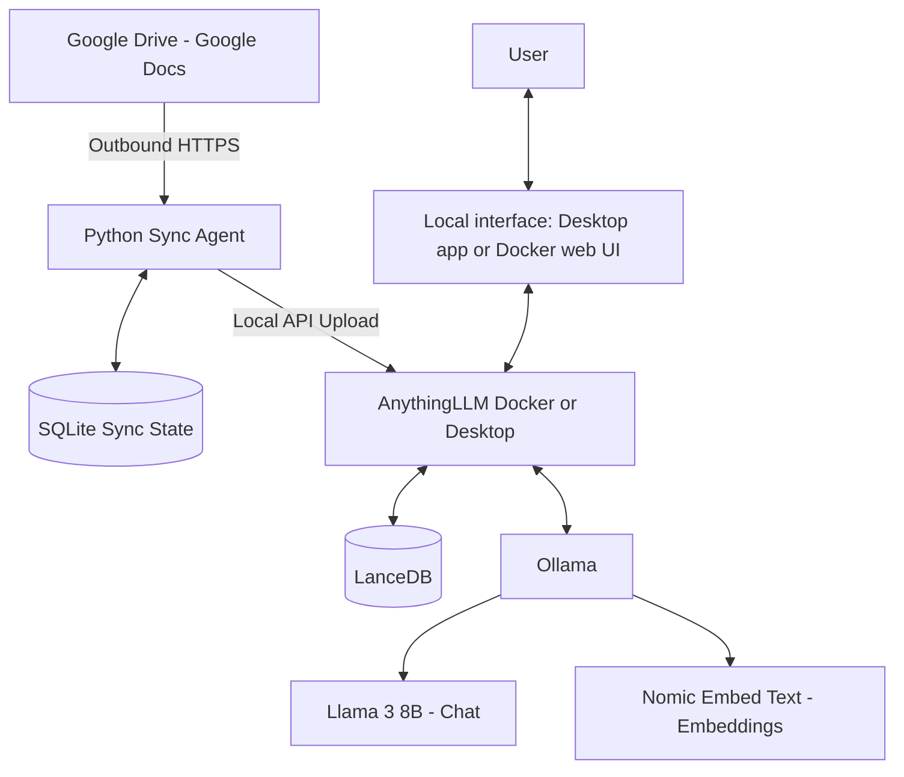

# Secure Local RAG

**A local AI knowledge assistant for Google Docs, powered by AnythingLLM and Ollama.**

Secure Local RAG synchronizes Google Docs from a configured Google Drive folder and makes their content searchable through a local Retrieval-Augmented Generation (RAG) assistant. The first release is designed for one user on one Windows computer.

## Features

- Syncs Google Docs from one Google Drive folder, including nested folders.
- Exports Google Docs to PDF before sending them to the local RAG system.
- Checks for changes on a configurable schedule (15 minutes by default).
- Uses SQLite to remember sync state and avoid unnecessary reprocessing.
- Detects documents that are removed from the configured Drive folder and removes them from the active AnythingLLM workspace.
- Runs chat and embedding models locally through Ollama.
- Uses AnythingLLM to manage document ingestion, workspaces, retrieval, and the LanceDB vector store.

## Architecture

## Technology Stack

| Component | Purpose |
|---|---|
| Google Drive API | Read Google Docs and folder metadata |
| Python Sync Agent | Discover, export, and synchronize documents |
| SQLite | Store synchronization state |
| AnythingLLM | Local RAG interface, workspaces, and document processing (Docker or Desktop) |
| LanceDB | Vector storage managed by AnythingLLM |
| Ollama | Local model runtime |
| Llama 3 8B / Hermes 3 8B | Chat and answer generation |
| `nomic-embed-text` | Text embeddings |

## Requirements

- Windows computer (the setup guides target Windows).
- Either Docker Desktop with Linux containers enabled (Docker deployment), or AnythingLLM Desktop (single-user alternative).
- Ollama for local model hosting.
- Python 3.10 or newer for the Sync Agent.
- An NVIDIA GPU is recommended for local model performance. The initial target is an RTX 3070 with 8 GB VRAM; actual model fit and speed must be tested on the host.
- Internet access for initial downloads and outbound Google Drive synchronization.

## V1 Scope

| Included in V1 | Not included in V1 |
|---|---|
| One user on one Windows computer | Multi-user access from other computers |
| One configured Google Drive folder tree | Multiple independent Drive sources |
| Google Docs only | Google Sheets, Slides, Word, or general PDF ingestion |
| Local Ollama inference | Hosted LLM or embedding providers |
| Local AnythingLLM instance | Public or LAN-facing deployment |

See [PROJECT_SCOPE.md](PROJECT_SCOPE.md) for the detailed scope, design decisions, limitations, and acceptance checks.

## Getting Started

Choose the setup guide for your preferred language. Both guides walk through installation and configuration from the beginning.

- [English Setup Guide](SETUP.md)
- [دليل الإعداد باللغة العربية](SETUP_AR.md)

At a high level, setup consists of:

1. Install Python and Ollama; install Docker Desktop **or** AnythingLLM Desktop.
2. Download the required Ollama models.
3. Run AnythingLLM locally (Docker is the primary documented path; Desktop is a single-user alternative) and connect it to Ollama.
4. Enable the Google Drive API and create a read-only service account.
5. Place `.env` and `credentials.json` in `sync_agent/` (local files only).
6. Install dependencies in `sync_agent/.venv` and start the agent with `sync_agent/start_sync.bat` or the virtual-environment Python executable.

Do not skip the detailed setup guide; it includes the exact commands, configuration values, and verification steps.

## Repository Files

| File / Folder | Description |
|---|---|
| [`SETUP.md`](SETUP.md) | Complete installation and setup guide in English |
| [`SETUP_AR.md`](SETUP_AR.md) | Complete installation and setup guide in Arabic |
| [`PROJECT_SCOPE.md`](PROJECT_SCOPE.md) | V1 requirements, boundaries, limitations, and future plans |
| [`sync_agent/sync_agent.py`](sync_agent/sync_agent.py) | Python Google Drive synchronization agent |
| [`sync_agent/requirements.txt`](sync_agent/requirements.txt) | Python dependencies |
| [`sync_agent/.env.example`](sync_agent/.env.example) | Example configuration with placeholders |
| [`sync_agent/start_sync.bat`](sync_agent/start_sync.bat) | One-click Windows launcher using the project virtual environment |
| `anythingllm_data/` | Local persistent storage created only for the Docker deployment; ignored by Git |
| `models/` | Optional local Modelfiles or manual model backups; not Ollama's default model directory |
| [`.gitignore`](.gitignore) | Excludes local secrets, virtual environments, and runtime data from Git |

The Sync Agent files are grouped under `sync_agent/`. Its `.env`, `credentials.json`, `.venv/`, and runtime folders are created locally and must not be committed. Docker storage is kept in `anythingllm_data/` when using Docker; AnythingLLM Desktop manages its own local storage.

## Privacy and Security

- AI inference, embeddings, and vector storage are designed to run locally.
- The Sync Agent makes **outbound HTTPS requests** to Google Drive to list and export source documents. Google Drive remains a cloud dependency; this project is not air-gapped.
- Use the read-only Google Drive scope and share only the folder intended for synchronization with the service account.
- Keep `sync_agent/.env` and `sync_agent/credentials.json` private. Never commit real API keys or service-account credentials.
- The default V1 deployment binds AnythingLLM to `127.0.0.1`, limiting access to the local computer.
- Do not configure a cloud-hosted LLM or embedding provider if local-only inference is required.

**Privacy description:** local AI processing and inference with outbound Google Drive synchronization. The project should not be described as fully air-gapped or 100% on-premise because its source documents remain in Google Drive.

## Current Status

This is a **single-user V1 pilot**. Validate the installation, API compatibility, document update and removal behavior, model performance, and backup procedure in your own environment before relying on it for business-critical information.

A document removed from the active AnythingLLM workspace is not necessarily purged from AnythingLLM's global document library. Review the deletion note in [PROJECT_SCOPE.md](PROJECT_SCOPE.md) before treating the sync process as a complete data purge.

---

Contributions, issue reports, and practical improvements are welcome. Please do not include credentials, private company documents, or API keys in issues or pull requests.
