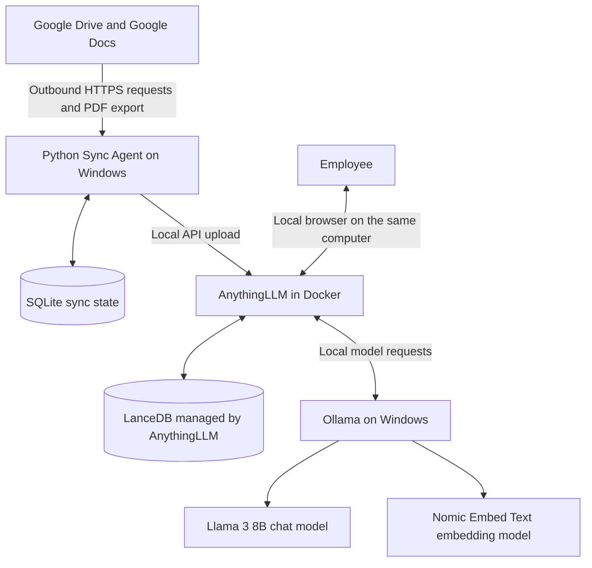

# Installation & Setup Guide — Secure Local RAG

> **This guide walks you through installing and running the project from scratch on Windows.** Follow the sections in order. Complete each verification check before moving to the next section.
>
> **V1 scope:** one user on one Windows computer, one Google Drive folder tree (including subfolders), and Google Docs only.

## Before you begin: what are we installing?



### Important privacy boundary

The embedding, retrieval, and answer-generation workloads are intended to run locally. However, Google Drive remains a cloud service: the Python Sync Agent connects to Google over the internet to list file metadata and export Google Docs. This is **not an air-gapped system**. A precise description is **local AI processing and inference with outbound Google Drive synchronization**.

Initial software installation, model downloads, software updates, and Google Drive synchronization also require internet access.

---

## 1. Download the project and check its files

After downloading and extracting the repository, the project folder should look similar to this:

```text
SecureLocalRAG/
├── README.md
├── SETUP.md
├── SETUP_AR.md
├── PROJECT_SCOPE.md
├── sync_agent.py
├── requirements.txt
├── .env.example
└── .gitignore

# Created locally during setup (never commit):
├── credentials.json
├── .env
├── data/
├── logs/
└── tmp/
```

The `.env` and `credentials.json` files are private local files. They should **not** be included in the GitHub repository. The `.env.example` file is safe to commit because it contains placeholders rather than real credentials.

### Download the repository

1. Open the project repository on GitHub.
2. Select **Code → Download ZIP**.
3. Extract the ZIP file to a short, simple path, for example:

```text
C:\SecureLocalRAG
```

4. Open the extracted folder and confirm that `sync_agent.py`, `requirements.txt`, `.env.example`, and `.gitignore` are present.

> `sync_agent.py` is a standalone file in the repository. Keep it in the project root next to `requirements.txt`. Do not copy the code from another document or paste Markdown fences into the Python file.

---

## 2. Install Docker Desktop

Docker runs AnythingLLM. Ollama and the Python Sync Agent will run directly on Windows.

### 2.1 Check Windows and virtualization

1. Press **Start**, type `winver`, and check your Windows version.
2. Review Docker's current [Windows installation requirements](https://docs.docker.com/desktop/setup/install/windows-install/).
3. Docker Desktop uses WSL 2 by default for most Windows installations. Hardware virtualization must be enabled in BIOS/UEFI.
4. Open PowerShell and check WSL:

```powershell
wsl --version
```

5. If WSL is not installed, follow Microsoft's [WSL installation guide](https://learn.microsoft.com/windows/wsl/install). Then restart Windows if requested.
6. Update WSL:

```powershell
wsl --update
```

**Windows support note:** Windows 10 reached its general end-of-support date on October 14, 2025. Prefer a currently supported Windows 11 release for a new installation. If you plan to use Windows 10, verify that your exact Windows edition and servicing/ESU status are still supported by both Microsoft and the current Docker Desktop requirements. Microsoft explains the end-of-support date and ESU options [here](https://support.microsoft.com/en-us/windows/deployment/updates-lifecycle/windows-10-support-has-ended-on-october-14-2025). Docker's current WSL 2 requirements specify WSL 2.1.5 or later and list supported Windows editions/releases; check the official page before installing.

### 2.2 Install Docker Desktop

1. Download [Docker Desktop for Windows](https://www.docker.com/products/docker-desktop/).
2. Run the installer.
3. Select the **WSL 2** backend when prompted, unless your environment requires another supported backend.
4. Finish the installation and restart Windows if requested.
5. Open Docker Desktop from the Start menu.
6. Accept the Docker terms and wait until Docker Desktop reports that the engine is running.
7. Make sure Docker is using **Linux containers**.

> **Commercial licensing:** Docker Desktop commercial use in larger organizations may require a paid subscription. Docker currently specifies a paid subscription for organizations with **more than 250 employees OR more than USD 10 million in annual revenue**. Review Docker's [current terms and installation documentation](https://docs.docker.com/desktop/setup/install/windows-install/) before using it at work.

### 2.3 Verify Docker

Open a new PowerShell window and run:

```powershell
docker version
docker info --format '{{.OSType}}'
```

The second command should print:

```text
linux
```

If Docker reports that it cannot connect to the daemon, open Docker Desktop and wait until startup has completed.

---

## 3. Install Ollama and download the models

Ollama runs the language and embedding models locally on the Windows host.

### 3.1 Install Ollama

1. Download [Ollama for Windows](https://ollama.com/download/windows).
2. Run the installer.
3. Open a new PowerShell window.
4. Verify that the command is available:

```powershell
ollama --version
```

Ollama normally starts its local service automatically after installation.

### 3.2 Download the two models

Download the chat model:

```powershell
ollama pull llama3:8b
```

Download the embedding model:

```powershell
ollama pull nomic-embed-text
```

Check that both models are installed:

```powershell
ollama list
```

You should see `llama3:8b` and `nomic-embed-text` in the list.

### 3.3 Verify the Ollama service

Open this address in your browser:

[http://127.0.0.1:11434](http://127.0.0.1:11434)

You should see a message indicating that Ollama is running. If the page does not respond, open the Ollama application from the Start menu. If needed, start the service in a separate PowerShell window with:

```powershell
ollama serve
```

### 3.4 Check GPU usage

If you have an NVIDIA GPU, run:

```powershell
nvidia-smi
ollama ps
```

`nvidia-smi` displays GPU memory usage. `ollama ps` displays models currently loaded by Ollama. Run these checks while a model is actively answering a question.

> An NVIDIA RTX 3070 with 8 GB of VRAM is a reasonable starting point for testing an 8B quantized model, but actual performance depends on context length, model quantization, available system RAM, and other GPU workloads. Downloading a model does not guarantee that the entire model and its context will fit in VRAM. Test with real questions before relying on it.

---

## 4. Run AnythingLLM in Docker

### 4.1 Create the persistent storage folder

Copy the following commands into PowerShell:

```powershell
$storage = 'C:\anythingllm_data'
New-Item -ItemType Directory -Force -Path $storage | Out-Null

$anythingEnv = Join-Path $storage '.env'
if (-not (Test-Path $anythingEnv)) {
    New-Item -ItemType File -Path $anythingEnv | Out-Null
}
```

This folder stores AnythingLLM data on the Windows host so it is not lost when the container is recreated.

> There will be **two different `.env` files** in this setup:
>
> - `C:\anythingllm_data\.env` belongs to the AnythingLLM Docker container.
> - `C:\SecureLocalRAG\.env` belongs to the Python Sync Agent and stores its configuration.
>
> Do not mix these files. The Python agent's `.env` is created in Section 7.

### 4.2 Download the AnythingLLM image

```powershell
docker pull mintplexlabs/anythingllm:latest
```

**Security version check:** Do not deploy AnythingLLM **v1.16.1**. The published security advisory identifies v1.16.1 as affected and lists versions newer than 1.16.1 as patched. Use a current patched release, and check the [official security advisory](https://github.com/Mintplex-Labs/anything-llm/security/advisories/GHSA-3f4c-xj8r-h4cr) and release notes before deployment. For a production deployment, record and pin the exact version you tested rather than relying indefinitely on a floating `latest` tag.

### 4.3 Start the container

Run this command in PowerShell. Keep the backtick character (`` ` ``) at the end of each continued line:

```powershell
docker run -d --name anythingllm --restart unless-stopped `
  -p 127.0.0.1:3001:3001 `
  --cap-add SYS_ADMIN `
  -v "C:\anythingllm_data:/app/server/storage" `
  -v "C:\anythingllm_data\.env:/app/server/.env" `
  -e STORAGE_DIR=/app/server/storage `
  mintplexlabs/anythingllm:latest
```

Why these options are used:

- `--name anythingllm` gives the container a predictable name for later commands.
- `--restart unless-stopped` allows Docker to restart the container when the Docker engine restarts, unless you explicitly stopped it.
- `-p 127.0.0.1:3001:3001` exposes the web interface only on the local computer for V1. It does not intentionally publish the service to the LAN.
- The storage volume keeps AnythingLLM data on the host.
- `SYS_ADMIN` is included in the official AnythingLLM Docker run example. It is a broad Linux capability. Keep the documented command for the initial supported setup; if you want to remove this capability, test that separately in a disposable environment and verify startup, PDF processing, embedding, and restart behavior before changing the working deployment.

### 4.4 Verify the container

Run:

```powershell
docker ps
docker logs --tail 50 anythingllm
```

You should see a container named `anythingllm` with a status similar to `Up`.

Open the web interface:

[http://localhost:3001](http://localhost:3001)

Do not continue to the Google Drive setup until the AnythingLLM page loads successfully.

---

## 5. Configure AnythingLLM and connect it to Ollama

Complete the initial setup in your browser.

### 5.1 Set up single-user access

1. Keep the instance in **Single-user Mode**. Do not enable Multi-user Mode for V1.
2. In the instance security settings, enable **Password Protect Instance** and set a strong password.
3. Store the password safely. Anyone who has this single-user password can access the instance and its settings, workspaces, and chats.

The wording or location of settings can change slightly between AnythingLLM releases. See the official [Security and Access documentation](https://docs.anythingllm.com/features/security-and-access).

### 5.2 Configure the chat model

1. Open the AI provider or LLM settings in AnythingLLM.
2. Select **Ollama** as the chat/LLM provider.
3. Set the Ollama URL to:

```text
http://host.docker.internal:11434
```

4. Select this model:

```text
llama3:8b
```

5. Save the setting.

### 5.3 Configure the embedding model

1. Open the embedding provider settings.
2. Select **Ollama**.
3. Use the same Ollama URL:

```text
http://host.docker.internal:11434
```

4. Select the embedding model:

```text
nomic-embed-text
```

5. Save the setting.

If AnythingLLM asks you to choose a vector database, keep its local default or select **LanceDB** if the option is shown. Do not install LanceDB as a separate service; AnythingLLM manages the local vector store.

### Important: the project uses two different local URLs

| Connection | URL | Why |
|---|---|---|
| AnythingLLM (inside Docker) → Ollama (on Windows) | `http://host.docker.internal:11434` | Allows the Docker container to reach a service running on the Windows host |
| Python Sync Agent (on Windows) → AnythingLLM (local Docker port) | `http://127.0.0.1:3001/api/v1` | Python runs directly on Windows and connects through the host's loopback address |

**Do not enter `localhost` or `127.0.0.1` as the Ollama URL inside Dockerized AnythingLLM.** Inside the container, those addresses refer to the container itself, not the Windows host. See [AnythingLLM's Ollama/Docker troubleshooting guide](https://docs.anythingllm.com/ollama-connection-troubleshooting).

### 5.4 Create a Workspace

1. Create a new Workspace in AnythingLLM.
2. Give it a simple name, for example:

```text
company-documents
```

3. If the interface shows both a display name and a separate **slug**, record the slug. The Python agent needs the exact slug.

### 5.5 Create an API key

1. Open **Developer API** in the AnythingLLM settings. The menu location may vary by release.
2. Generate a new API key.
3. Copy it and store it securely. Anyone who has this key can use the AnythingLLM API, so never publish or share it.

Your local API documentation is available at:

[http://localhost:3001/api/docs](http://localhost:3001/api/docs)

See the official [API Access & Keys documentation](https://docs.useanything.com/features/api).

### 5.6 Confirm the Workspace slug

Do not assume that the display name and slug are identical.

1. Open [AnythingLLM API Docs](http://localhost:3001/api/docs).
2. Find the `GET /v1/workspaces` operation (the local documentation may display the route without the `/api` prefix).
3. Use **Try it out** and **Execute**. Authorize with your API key if the page requests it.
4. Find the Workspace you created and copy its `slug` value exactly.
5. You will paste this value into `WORKSPACE_SLUG` in the Python `.env` file in Section 7.

The labels or API documentation layout may differ slightly by AnythingLLM version. Never share screenshots or API responses that expose your API key.

---

## 6. Configure Google Drive access

The Python agent uses a Google service account with read-only Drive access. You will share the target folder with this account.

### 6.1 Create a Google Cloud project and enable the Drive API

1. Open the [Google Cloud Console](https://console.cloud.google.com/).
2. Create a new project, or select an existing project.
3. Open the [Google Drive API page](https://console.cloud.google.com/apis/library/drive.googleapis.com).
4. Select **Enable**.

### 6.2 Create a service account

1. In Google Cloud Console, open **IAM & Admin → Service Accounts**.
2. Select **Create Service Account**.
3. Give it a recognizable name, for example:

```text
gdrive-rag-reader
```

4. Complete the creation process. You do not need to grant this service account a broad project role just to read a Drive folder that you explicitly share with it; Drive access is granted through the folder sharing settings.
5. Open the new service account and go to **Keys**.
6. Select **Add key → Create new key → JSON**.
7. Download the JSON key file and rename it:

```text
credentials.json
```

8. Keep this file private. Place it in the project root next to `sync_agent.py` in Section 7.

> Some Google Workspace or Cloud organizations prohibit service-account key creation or external sharing. If either action is blocked, ask the organization's Google Workspace/Cloud administrator for an approved authentication and sharing method. Do not bypass company policy.

### 6.3 Share the target Drive folder with the service account

1. Open the service account details page and copy its email address. It usually ends with:

```text
.iam.gserviceaccount.com
```

2. Open Google Drive using your normal account.
3. Right-click the **top-level folder** you want to synchronize.
4. Select **Share**.
5. Paste the service account email address.
6. Set its role to **Viewer** only.
7. Save the sharing settings.

The service account must be able to see the root folder and the nested folders that should be synchronized. If you use a Shared Drive, make sure the service account has the appropriate read-only membership/access on that Shared Drive. Organization sharing policies may restrict this.

### 6.4 Copy the Google Drive Folder ID

Open the top-level folder in your browser. Its URL will look similar to:

```text
https://drive.google.com/drive/folders/1AbCDefGhijkLMNopQRstuVWxyz
```

Copy only the value after `/folders/`. This is the `DRIVE_FOLDER_ID`.

The project folder should now contain:

```text
C:\SecureLocalRAG\credentials.json
```

**Never commit `credentials.json` to GitHub or send it to anyone.** It contains a private service-account key.

---

## 7. Set up the Python Sync Agent

### 7.1 Open PowerShell in the project folder

If you extracted the repository to `C:\SecureLocalRAG`, run:

```powershell
Set-Location C:\SecureLocalRAG
```

Check that Python 3.10 or newer is installed:

```powershell
py -3 --version
```

If Python is not found, download it from [python.org](https://www.python.org/downloads/windows/), install it, and open a new PowerShell window. Enable the option to add Python to `PATH` if the installer offers it.

### 7.2 Create a virtual environment and install dependencies

Run these commands in order:

```powershell
py -3 -m venv .venv
.\.venv\Scripts\python.exe -m pip install --upgrade pip
.\.venv\Scripts\python.exe -m pip install -r requirements.txt
```

The commands use the Python executable inside `.venv` directly. You do not need to activate the virtual environment or change the PowerShell execution policy.

### 7.3 Create the Python configuration file

Copy the example file, then open the new `.env` file:

```powershell
Copy-Item .env.example .env
notepad .env
```

Replace the placeholder values with the information you collected in the earlier sections:

```dotenv
# Google Drive
GOOGLE_CREDENTIALS_FILE=credentials.json
DRIVE_FOLDER_ID=PASTE_GOOGLE_DRIVE_FOLDER_ID_HERE

# AnythingLLM API - Python runs directly on Windows
ANYTHINGLLM_BASE_URL=http://127.0.0.1:3001/api/v1
ANYTHINGLLM_API_KEY=PASTE_ANYTHINGLLM_API_KEY_HERE
WORKSPACE_SLUG=company-documents

# Sync interval in minutes
CHECK_INTERVAL_MINUTES=15

# Local state and logs
STATE_DB_PATH=./data/sync_state.sqlite3
LOG_PATH=./logs/sync_agent.log
TEMP_DIR=./tmp
```

Save the file and close Notepad.

Check these settings carefully:

- `GOOGLE_CREDENTIALS_FILE`: keep `credentials.json` if the file is in the project root.
- `DRIVE_FOLDER_ID`: enter only the folder ID copied from Google Drive, not the full URL.
- `ANYTHINGLLM_BASE_URL`: keep `http://127.0.0.1:3001/api/v1`. Do not replace it with `host.docker.internal`; that address is for the Docker container to reach Ollama.
- `ANYTHINGLLM_API_KEY`: paste the key generated in AnythingLLM.
- `WORKSPACE_SLUG`: enter the exact slug returned by the AnythingLLM API. `company-documents` is only an example; use it only if it matches your actual Workspace slug.
- `CHECK_INTERVAL_MINUTES`: defaults to 15 minutes. You can change it later if needed.

### 7.4 Check `.gitignore` and protect secrets

Make sure the repository's `.gitignore` contains at least:

```gitignore
.env
credentials.json
data/
logs/
tmp/
__pycache__/
*.py[cod]
.venv/
```

Commit `.env.example`, but never commit `.env` or `credentials.json`.

---

## 8. Run the Sync Agent for the first time

Before you start, confirm that:

- Docker Desktop is open and the `anythingllm` container is running.
- Ollama is running on Windows.
- AnythingLLM can connect to both Ollama models.
- You created the Workspace and copied its API key and slug.
- You shared the Google Drive folder with the service account.
- The project folder contains the configured `.env` and `credentials.json` files.

From PowerShell, in the project folder, run:

```powershell
.\.venv\Scripts\python.exe sync_agent.py
```

During the first synchronization cycle, the agent will:

1. Validate its configuration and check the AnythingLLM API key.
2. Connect to Google Drive.
3. Scan the configured folder and its nested folders.
4. Find Google Docs files only.
5. Export new or changed Google Docs as PDF files.
6. Upload the PDFs to AnythingLLM and add them to the configured Workspace.
7. Save synchronization state in SQLite.
8. Repeat the scan every 15 minutes by default.

**Keep the PowerShell window open.** In V1, the Sync Agent runs as a foreground Python process in this window. It is not automatically installed as a Windows Service. Closing the window or pressing `Ctrl+C` stops synchronization. A Windows Task Scheduler job can be considered later after the pilot works reliably.

Do not run multiple copies of `sync_agent.py` at the same time. Run one agent process only to avoid overlapping synchronization cycles.

### Where are the local state and logs stored?

The agent creates these folders/files automatically:

```text
data/sync_state.sqlite3
logs/sync_agent.log
tmp/
```

- `sync_state.sqlite3` stores each document's synchronization state so unchanged files are not uploaded repeatedly.
- `sync_agent.log` records activity and errors.
- `tmp/` holds temporary PDF exports and is cleaned up after processing.

---

## 9. Test the system before relying on it

Start with a small test folder containing one or two Google Docs. Do not point the first test at the full company folder.

| Test | What to do | Expected result |
|---|---|---|
| New document | Create a Google Doc in the shared folder | The agent detects it, uploads it, and it becomes searchable in the Workspace |
| Nested folder | Create a subfolder and place a Google Doc inside it | The agent discovers and indexes the nested document |
| Unchanged document | Wait for another sync cycle without editing the document | The agent skips unnecessary download/upload work |
| Edited document | Add a unique test sentence to an existing Google Doc | The next sync cycle updates the indexed content; a question about the new sentence can retrieve it |
| Deleted document | Delete the test document from the configured Drive folder | The agent removes its association from the Workspace after a complete successful Drive scan |
| Restart the agent | Stop it with `Ctrl+C`, then start it again | The agent reads SQLite and does not treat all existing documents as new |

After each test, review:

```text
logs/sync_agent.log
```

Then open [AnythingLLM](http://localhost:3001) and ask a question whose answer is clearly stated in the test document. Check whether the relevant source/document appears in the answer details, depending on the UI version.

> **Deletion behavior:** This V1 process removes a deleted document from the active Workspace. It does not necessarily delete the file permanently from AnythingLLM's global document library or every local storage location. Do not treat Workspace removal as permanent erasure or as compliance-grade data deletion. A separate global deletion workflow would need to be designed and tested.

### Known Google Docs export limit

The Google Drive API `files.export` method currently limits exported content to **10 MB**. A Google Doc that exceeds the export limit may fail to synchronize. See Google's [Export Google Workspace documents documentation](https://developers.google.com/workspace/drive/api/reference/rest/v3/files/export) and [Download and export files guide](https://developers.google.com/workspace/drive/api/guides/manage-downloads).

---

## 10. Daily operation and shutdown

### Start the system after turning on the computer

1. Open Docker Desktop and wait until its engine is running.
2. Make sure Ollama is running. It normally starts automatically with Windows.
3. Open [http://localhost:3001](http://localhost:3001) and confirm that AnythingLLM loads. Because the container uses `--restart unless-stopped`, Docker should restart it when the engine starts unless you previously stopped it.
4. Open PowerShell in the project folder.
5. Start the Sync Agent:

```powershell
.\.venv\Scripts\python.exe sync_agent.py
```

### Stop synchronization

Press `Ctrl+C` in the PowerShell window running the Sync Agent.

### Check the AnythingLLM container

```powershell
docker ps
docker logs --tail 100 anythingllm
```

### Start AnythingLLM if the container is stopped

```powershell
docker start anythingllm
```

Do not delete `C:\anythingllm_data`. It contains AnythingLLM's local storage and database.

---

## 11. Troubleshooting

| Problem | What to check |
|---|---|
| `docker` command is not recognized | Confirm Docker Desktop is installed, then open a new PowerShell window |
| Docker engine is not running | Open Docker Desktop; check WSL 2, Windows support, and hardware virtualization |
| `localhost:3001` does not open | Run `docker ps` and `docker logs --tail 100 anythingllm` |
| AnythingLLM cannot see Ollama models | In AnythingLLM's Ollama settings, use `http://host.docker.internal:11434`; confirm Ollama is running on Windows |
| Ollama does not respond | Open `http://127.0.0.1:11434` or start the Ollama app |
| A model does not appear in AnythingLLM | Run `ollama list`, verify the exact model tag, and re-save the provider settings |
| Google returns `403` or `404` | Check that Drive API is enabled, the Folder ID is correct, and the service account has Viewer access to the folder |
| AnythingLLM returns `401` | Generate a new API key and update `ANYTHINGLLM_API_KEY` in the Python `.env` file |
| Workspace not found | Check `WORKSPACE_SLUG` against the actual slug returned by the AnythingLLM API |
| Python reports a missing package | Run `.\.venv\Scripts\python.exe -m pip install -r requirements.txt` from the project folder |
| The Sync Agent exits immediately | Check the first error in `logs/sync_agent.log`; confirm no `PASTE_...` placeholders remain in `.env` |
| A Google Doc fails during PDF export | Check whether the document exceeds the Drive API export size limit and whether the service account can view it |
| GPU memory is full | Check `nvidia-smi` and `ollama ps`; reduce context length or test a smaller model if necessary |

---

## 12. Security and backups

Follow these rules even during testing:

- Never commit `.env` or `credentials.json` to GitHub.
- Never share the AnythingLLM API key or the service-account private key.
- Keep AnythingLLM bound to `127.0.0.1` for V1. Do not change the port mapping to `0.0.0.0` or `3001:3001` to expose it to the LAN.
- Keep AnythingLLM in Single-user Mode for V1. Anyone who knows the instance password can access all content and settings available to that instance.
- Give the Google service account **Viewer** access only.
- Do not configure a hosted/cloud LLM or embedding provider if the requirement is to keep embeddings and inference local.
- Remember that synchronization still sends outbound requests to Google Drive over the internet.
- Review the Docker and AnythingLLM security advisories before updating the deployment.

### What should be backed up?

1. The complete `C:\anythingllm_data` folder.
2. `data\sync_state.sqlite3` from the project folder.
3. A secure, encrypted copy of `.env` and `credentials.json`, handled according to your organization's credential policy. Alternatively, rotate/recreate credentials when required.

Do not delete the SQLite database as a troubleshooting shortcut. The agent uses it to remember which documents have already been synchronized. Removing it can cause previously indexed documents to be processed again.

---

## 13. What we are deliberately not adding to V1

To keep the first version small and maintainable, it does not require:

- Redis, Kafka, Kubernetes, or PostgreSQL.
- A separately managed LanceDB service.
- PDF uploads, Google Sheets, Word documents, or other file sources.
- Access from other computers on the network.
- A reverse proxy or internal HTTPS setup before multi-device access is actually required.
- A Windows Service before the basic synchronization workflow has been tested.

After the single-user pilot is successful, consider a dedicated always-on company workstation, multi-user access, additional data sources, and a managed startup process as separate improvements.

---

## Official downloads and documentation

### Core software

- [Docker Desktop for Windows](https://www.docker.com/products/docker-desktop/)
- [Docker Desktop — Windows installation requirements](https://docs.docker.com/desktop/setup/install/windows-install/)
- [Microsoft — Install WSL](https://learn.microsoft.com/windows/wsl/install)
- [Ollama for Windows](https://ollama.com/download/windows)
- [Ollama — Llama 3 model](https://ollama.com/library/llama3)
- [Ollama — Nomic Embed Text model](https://ollama.com/library/nomic-embed-text)
- [Python for Windows](https://www.python.org/downloads/windows/)

### AnythingLLM

- [AnythingLLM — Docker Quickstart](https://docs.anythingllm.com/installation-docker/quickstart)
- [AnythingLLM — Local Docker installation](https://docs.anythingllm.com/installation-docker/local-docker)
- [AnythingLLM — Ollama/Docker troubleshooting](https://docs.anythingllm.com/ollama-connection-troubleshooting)
- [AnythingLLM — API Access & Keys](https://docs.useanything.com/features/api)
- [AnythingLLM — Security and Access](https://docs.anythingllm.com/features/security-and-access)
- [AnythingLLM — Security advisory for v1.16.1](https://github.com/Mintplex-Labs/anything-llm/security/advisories/GHSA-3f4c-xj8r-h4cr)

### Google Drive

- [Google Cloud Console](https://console.cloud.google.com/)
- [Google Drive API](https://console.cloud.google.com/apis/library/drive.googleapis.com)
- [Google Cloud — Create service accounts](https://cloud.google.com/iam/docs/service-accounts-create)
- [Google Cloud — Create and manage service-account keys](https://cloud.google.com/iam/docs/keys-create-delete)
- [Google Drive API — files.list](https://developers.google.com/workspace/drive/api/reference/rest/v3/files/list)
- [Google Drive API — files.export](https://developers.google.com/workspace/drive/api/reference/rest/v3/files/export)
- [Google Drive API — Download and export files](https://developers.google.com/workspace/drive/api/guides/manage-downloads)
- [Google Drive Help — Share files and folders](https://support.google.com/drive/answer/7166529)

---

**Guide status:** Windows-first setup instructions for the single-user V1 pilot. Complete the tests in Section 9 before using the system with real company documents.
