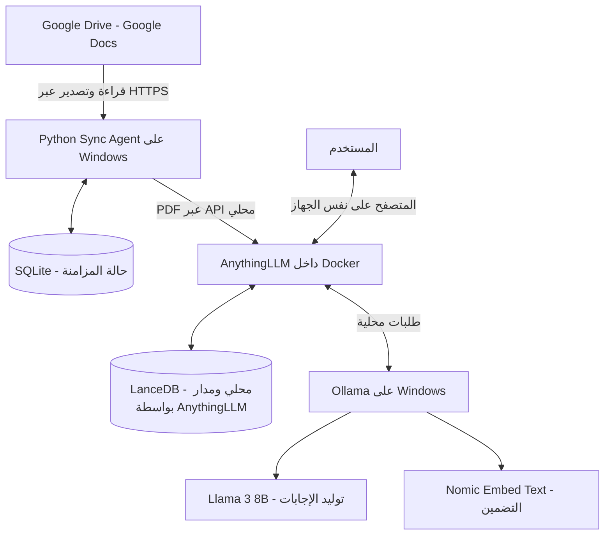

# دليل الإعداد والتشغيل — Secure Local RAG

> **هذا الملف هو دليل التنفيذ العملي للمشروع من الصفر على Windows.** اتبع الخطوات بالترتيب. لا تنتقل إلى المرحلة التالية قبل نجاح اختبار المرحلة الحالية.
>
> نطاق هذا الإصدار: مستخدم واحد على جهاز Windows واحد، ومجلد Google Drive واحد يشمل المجلدات الفرعية، وملفات Google Docs فقط.

---

## قبل أن تبدأ: ما الذي سنشغّله؟



**مهم بشأن الخصوصية:** النماذج والتضمين والبحث وتوليد الإجابات تعمل محليًا. لكن Google Drive يبقى خدمة سحابية؛ يتصل به Python Sync Agent عبر الإنترنت لجلب بيانات الملفات وتصدير المستندات. لذلك هذا المشروع ليس جهازًا معزولًا عن الإنترنت (Air-gapped)، بل نظام استدلال محلي مع مزامنة سحابية صادرة.

## 1. تأكد من وجود ملفات المشروع

بعد تنزيل المشروع من GitHub وفك ضغطه، اجعل المجلد يحتوي على الملفات التالية في المستوى نفسه:

```text
secure-local-rag/
├── README.markdown
├── SETUP.md
├── sync_agent.py
├── requirements.txt
├── .env.example
├── .gitignore
├── credentials.json          # تضيفه أنت محليًا؛ لا ترفعه إلى GitHub
├── .env                      # تنشئه أنت محليًا؛ لا ترفعه إلى GitHub
├── data/                     # ينشئه السكريبت تلقائيًا
├── logs/                     # ينشئه السكريبت تلقائيًا
└── tmp/                      # ينشئه السكريبت تلقائيًا
```

إذا كان المستودع يحتوي على الكود داخل `README.markdown` فقط، فأنشئ ملفًا منفصلًا باسم `sync_agent.py` وانسخ إليه كتلة Python الكاملة من قسم **Python Sync Agent — complete source code** في README. يجب أن يكون الملف مستقلًا؛ لا تلصق علامات Markdown مثل علامات تنسيق Markdown الخاصة بكتل الكود داخل ملف Python.

### تنزيل المشروع إلى جهازك

1. افتح مستودع المشروع على GitHub.
2. اضغط **Code** ثم **Download ZIP**.
3. فك الضغط في مسار بسيط، مثل:

```text
C:\SecureLocalRAG
```

4. افتح المجلد وتأكد من وجود `sync_agent.py` و`requirements.txt` و`.env.example`.

> إذا كانت هذه الملفات غير موجودة، فلا تبدأ تشغيل السكريبت بعد. أضف ملفات التشغيل إلى المستودع أولًا، أو استخدم ملفاتها المنفصلة الموجودة في حزمة المشروع.

---

## 2. ثبّت Docker Desktop

سنستخدم Docker لتشغيل AnythingLLM فقط. سنشغّل Ollama وPython مباشرة على Windows.

1. تحقق من إصدار Windows بكتابة `winver` في قائمة Start.
2. راجع [متطلبات Docker Desktop لويندوز](https://docs.docker.com/desktop/setup/install/windows-install/). يتطلب تشغيل Docker Desktop على Windows إعداد WSL 2 أو أحد المحركات المدعومة، مع تفعيل Virtualization من BIOS/UEFI عند الحاجة.
3. إذا كان WSL 2 مثبتًا، افتح PowerShell وشغّل:

```powershell
wsl --update
wsl --version
```

4. إذا لم يكن WSL مثبتًا، اتبع [دليل تثبيت WSL الرسمي](https://learn.microsoft.com/windows/wsl/install)، ثم أعد تشغيل الجهاز عند طلب ذلك.
5. نزّل وثبّت [Docker Desktop for Windows](https://www.docker.com/products/docker-desktop/).
6. افتح Docker Desktop وانتظر حتى تظهر حالة أنه يعمل. استخدم محرك **Linux containers**.

> **ترخيص الشركة:** راجع شروط Docker Desktop قبل استخدامه تجاريًا. تنص وثائق Docker الحالية على أن المؤسسات التي يزيد عدد موظفيها عن 250 أو تتجاوز إيراداتها السنوية 10 ملايين دولار تحتاج إلى اشتراك مدفوع. راجع شروط الترخيص الرسمية من صفحة [Docker Desktop](https://docs.docker.com/desktop/setup/install/windows-install/).

### اختبر Docker

افتح PowerShell جديدًا واكتب:

```powershell
docker version
docker info --format '{{.OSType}}'
```

يجب أن يعرض الأمر الثاني:

```text
linux
```

إذا ظهر خطأ اتصال، افتح Docker Desktop وانتظر حتى يكتمل التشغيل قبل المتابعة.

---

## 3. ثبّت Ollama وحمّل النموذجين

Ollama هو الذي يشغّل نماذج الذكاء الاصطناعي محليًا على جهازك.

1. نزّل Ollama من [الموقع الرسمي](https://ollama.com/download/windows).
2. ثبّته كأي برنامج Windows عادي.
3. افتح PowerShell جديدًا وتأكد من عمله:

```powershell
ollama --version
```

4. حمّل نموذج التضمين:

```powershell
ollama pull nomic-embed-text
```

5. حمّل نموذج المحادثة:

```powershell
ollama pull llama3:8b
```

6. تأكد من ظهور النموذجين:

```powershell
ollama list
```

يجب أن ترى `nomic-embed-text` و`llama3:8b` في القائمة.

### اختبر خدمة Ollama

افتح هذا العنوان في المتصفح:

[http://127.0.0.1:11434](http://127.0.0.1:11434)

يفترض أن تظهر رسالة تفيد بأن Ollama يعمل. غالبًا يبدأ Ollama تلقائيًا بعد التثبيت. إذا لم يعمل، افتح تطبيق Ollama من قائمة Start أو شغّل `ollama serve` في نافذة PowerShell منفصلة.

إذا كان لديك NVIDIA GPU، تحقق من تعريف البطاقة واستهلاك الذاكرة:

```powershell
nvidia-smi
ollama ps
```

> RTX 3070 بذاكرة 8GB مناسبة لاختبار نموذج 8B مكمّم، لكن الأداء والذاكرة المتاحة يعتمدان على طول السياق والبرامج الأخرى. لا تعتبر نجاح تنزيل النموذج ضمانًا بأنه سيعمل دائمًا بكامل طبقاته داخل VRAM؛ اختبره فعليًا.

---

## 4. شغّل AnythingLLM داخل Docker

### 4.1 جهّز مجلد التخزين

انسخ الأوامر التالية كاملة إلى PowerShell:

```powershell
$storage = 'C:\anythingllm_data'
New-Item -ItemType Directory -Force -Path $storage | Out-Null

$anythingEnv = Join-Path $storage '.env'
if (-not (Test-Path $anythingEnv)) {
    New-Item -ItemType File -Path $anythingEnv | Out-Null
}
```

هذا المجلد يحفظ بيانات AnythingLLM حتى لا تضيع عند إعادة تشغيل الحاوية أو تحديثها.

> هذا الملف `C:\anythingllm_data\.env` خاص ببيئة حاوية AnythingLLM. لاحقًا سننشئ ملفًا آخر اسمه `.env` داخل مجلد المشروع لوضع إعدادات Python ومفاتيح الربط. لا تخلط بين الملفين.

### 4.2 نزّل صورة AnythingLLM

```powershell
docker pull mintplexlabs/anythingllm:latest
```

**تحقق من الإصدار قبل الاستخدام:** لا تستخدم AnythingLLM **v1.16.1**؛ يوجد لهذا الإصدار تنبيه أمني منشور. استخدم إصدارًا مُصححًا أحدث منه، وسجّل رقم الإصدار أو image digest الذي اختبرته. راجع [التنبيه الأمني الرسمي](https://github.com/Mintplex-Labs/anything-llm/security/advisories/GHSA-3f4c-xj8r-h4cr).

### 4.3 شغّل الحاوية

نفّذ هذا الأمر في PowerShell كما هو، مع إبقاء علامات backtick `` ` `` في نهاية الأسطر:

```powershell
docker run -d --name anythingllm --restart unless-stopped `
  -p 127.0.0.1:3001:3001 `
  --cap-add SYS_ADMIN `
  -v "C:\anythingllm_data:/app/server/storage" `
  -v "C:\anythingllm_data\.env:/app/server/.env" `
  -e STORAGE_DIR=/app/server/storage `
  mintplexlabs/anythingllm:latest
```

**لماذا نستخدم هذا الربط؟**

- `127.0.0.1:3001:3001` يجعل الواجهة متاحة من نفس الكمبيوتر فقط في V1، ولا يفتحها تلقائيًا لبقية أجهزة الشبكة.
- مجلد `C:\anythingllm_data` يحفظ بيانات AnythingLLM محليًا.
- `SYS_ADMIN` موجود في مثال Docker الرسمي لـ AnythingLLM. هذه صلاحية واسعة؛ نستخدم الأمر المتوافق أولًا، ثم يمكن اختبار حذفها في تشغيل تجريبي منفصل. لا تحذفها من نسخة عاملة قبل اختبار تشغيل التطبيق ورفع PDF واستخراج النص والتضمين وإعادة التشغيل.

### 4.4 تأكد من أن الحاوية تعمل

```powershell
docker ps
docker logs --tail 50 anythingllm
```

يجب أن ترى الحاوية باسم `anythingllm` وحالتها `Up`.

افتح الواجهة:

[http://localhost:3001](http://localhost:3001)

إذا لم تفتح، لا تنتقل إلى إعداد Google Drive؛ أصلح تشغيل الحاوية أولًا.

---

## 5. اضبط AnythingLLM واربطه بـ Ollama

أكمل الإعداد الأولي من المتصفح.

1. أنشئ كلمة مرور للواجهة وفعّل **Password Protect Instance**.
2. اترك النظام في **Single-user Mode**؛ لا تفعّل Multi-user في الإصدار الأول.
3. افتح إعدادات مزوّد النماذج (AI Providers / LLM Preference حسب إصدار الواجهة).
4. اختر **Ollama** كمزوّد نموذج المحادثة (LLM Provider).
5. في عنوان Ollama أدخل هذا العنوان تحديدًا:

```text
http://host.docker.internal:11434
```

6. اختر نموذج المحادثة:

```text
llama3:8b
```

7. افتح إعدادات التضمين (Embedder Preference)، واختر **Ollama**.
8. استخدم عنوان Ollama نفسه:

```text
http://host.docker.internal:11434
```

9. اختر نموذج التضمين:

```text
nomic-embed-text
```

10. احفظ الإعدادات. إذا طُلب منك اختيار Vector Database، اترك قاعدة البيانات المحلية الافتراضية أو اختر **LanceDB** إن ظهر الخيار. لا تثبّت LanceDB كخدمة منفصلة؛ AnythingLLM يديرها محليًا.

### انتبه: هناك عنوانان مختلفان في المشروع

| الاتصال | العنوان الصحيح | السبب |
|---|---|---|
| AnythingLLM داخل Docker يتصل بـ Ollama على Windows | `http://host.docker.internal:11434` | هذا العنوان يسمح للحاوية بالوصول إلى خدمة Ollama على الجهاز المضيف |
| Python على Windows يتصل بواجهة AnythingLLM المحلية | `http://127.0.0.1:3001/api/v1` | Python يعمل على Windows، والمنفذ مربوط محليًا |

**لا تضع `localhost` أو `127.0.0.1` في خانة Ollama داخل AnythingLLM عندما يعمل AnythingLLM داخل Docker.** داخل الحاوية يشير ذلك إلى الحاوية نفسها، وليس Windows. راجع [شرح AnythingLLM الرسمي للاتصال بـ Ollama من Docker](https://docs.anythingllm.com/ollama-connection-troubleshooting).

### 5.1 أنشئ Workspace

1. أنشئ مساحة عمل جديدة (Workspace).
2. سمّها مثلًا:

```text
company-documents
```

3. إذا كان AnythingLLM يعرض اسمًا ورمزًا (slug) منفصلين، احتفظ بالـ **slug** وليس الاسم الظاهر فقط. سنحتاجه في إعدادات Python.

### 5.2 أنشئ مفتاح API

1. من إعدادات AnythingLLM افتح **Developer API** (قد يظهر تحت Settings أو Tools بحسب إصدار الواجهة).
2. اضغط **Generate New API Key**.
3. انسخ المفتاح فور إنشائه واحفظه مؤقتًا في مكان آمن؛ لا ترسله لأحد ولا تضعه في GitHub.

توجد وثائق API الخاصة بنسختك هنا:

[http://localhost:3001/api/docs](http://localhost:3001/api/docs)

### 5.3 تأكد من Workspace Slug

لا تفترض أن الاسم الظاهر والـ slug متطابقان دائمًا. للحصول على القيمة الدقيقة:

1. افتح [AnythingLLM API Docs](http://localhost:3001/api/docs).
2. استخدم زر **Authorize** وأدخل API key إذا طلبته الصفحة.
3. ابحث عن العملية `GET /v1/workspaces` واضغط **Try it out** ثم **Execute**.
4. في النتيجة، ابحث عن مساحة العمل التي أنشأتها وانسخ قيمة `slug` كما هي.
5. ضع هذه القيمة في `WORKSPACE_SLUG` داخل ملف Python `.env` في المرحلة السابعة.

قد تختلف أسماء الأزرار قليلًا بحسب إصدار AnythingLLM. لا تنشر نتيجة الطلب إذا تضمنت أي معلومات حساسة.

---

## 6. جهّز وصول Google Drive

سننشئ Service Account مخصصًا للقراءة فقط، ثم نشارك معه مجلد Google Drive المطلوب.

### 6.1 أنشئ مشروع Google Cloud وفعّل Drive API

1. افتح [Google Cloud Console](https://console.cloud.google.com/).
2. أنشئ مشروعًا جديدًا أو اختر مشروعًا موجودًا.
3. افتح [Google Drive API](https://console.cloud.google.com/apis/library/drive.googleapis.com).
4. اضغط **Enable** لتفعيلها.

### 6.2 أنشئ Service Account

1. من Google Cloud Console افتح **IAM & Admin → Service Accounts**.
2. اضغط **Create Service Account**.
3. اكتب اسمًا، مثل:

```text
gdrive-rag-reader
```

4. أكمل الإنشاء. لا تحتاج إلى إعطاء الحساب دورًا عامًا على مشروع Google Cloud لمجرد قراءة المجلد الذي سنشاركه معه؛ الوصول إلى الملفات سيُمنح من Google Drive نفسه.
5. افتح حساب الخدمة الذي أنشأته، ثم انتقل إلى **Keys**.
6. اختر **Add key → Create new key → JSON**.
7. نزّل الملف. سمّه:

```text
credentials.json
```

إذا كانت سياسة المؤسسة تمنع إنشاء مفاتيح Service Account، لا تحاول الالتفاف عليها؛ اطلب من مسؤول Google Workspace/Cloud اعتماد طريقة مصادقة مناسبة للمؤسسة.

### 6.3 شارك مجلد Google Drive مع الحساب

1. من صفحة تفاصيل Service Account انسخ البريد الإلكتروني الذي ينتهي بـ:

```text
.iam.gserviceaccount.com
```

2. افتح Google Drive بحسابك المعتاد.
3. اضغط بزر الفأرة الأيمن على **المجلد الرئيسي** الذي تريد مزامنته.
4. اختر **Share**.
5. ألصق بريد Service Account.
6. امنحه صلاحية **Viewer** فقط.
7. احفظ المشاركة.

يجب أن يكون الحساب قادرًا على رؤية المجلد الرئيسي والمجلدات الفرعية التي تريد مزامنتها. إذا كنت تستخدم Shared Drive، امنح الحساب عضوية/صلاحية قراءة مناسبة لذلك القرص المشترك.

### 6.4 انسخ Folder ID

افتح المجلد الرئيسي في المتصفح. سيكون الرابط قريبًا من هذا الشكل:

```text
https://drive.google.com/drive/folders/1AbCDefGhijkLMNopQRstuVWxyz
```

انسخ الجزء الذي يأتي بعد `/folders/` فقط. هذا هو `DRIVE_FOLDER_ID`.

ضع `credentials.json` بجانب `sync_agent.py` داخل مجلد المشروع، مثل:

```text
C:\SecureLocalRAG\credentials.json
```

> هذا الملف يحتوي على مفتاح خاص. لا ترفعه إلى GitHub، ولا ترسله في محادثة، ولا تضع محتوياته في سجل الأوامر.

---

## 7. جهّز Python Sync Agent

### 7.1 افتح PowerShell داخل مجلد المشروع

مثال إذا كان المجلد في `C:\SecureLocalRAG`:

```powershell
Set-Location C:\SecureLocalRAG
```

تأكد من وجود Python 3.10 أو أحدث:

```powershell
py -3 --version
```

إذا لم يظهر إصدار Python، نزّل Python من [الموقع الرسمي](https://www.python.org/downloads/windows/) وثبّته، ثم افتح PowerShell جديدًا. فعّل خيار إضافة Python إلى PATH إذا ظهر في المثبّت.

### 7.2 أنشئ بيئة Python مستقلة وثبّت المكتبات

نفّذ الأوامر التالية بالترتيب:

```powershell
py -3 -m venv .venv
.\.venv\Scripts\python.exe -m pip install --upgrade pip
.\.venv\Scripts\python.exe -m pip install -r requirements.txt
```

استخدمنا مسار Python داخل `.venv` مباشرة حتى لا تحتاج إلى تفعيل البيئة أو تغيير Execution Policy في PowerShell.

### 7.3 أنشئ ملف إعدادات Python

انسخ نموذج الإعدادات:

```powershell
Copy-Item .env.example .env
notepad .env
```

ضع القيم التالية في `.env`، واستبدل القيم التي تبدأ بـ `PASTE_` بالمعلومات التي نسختها من الخطوات السابقة:

```dotenv
# Google Drive
GOOGLE_CREDENTIALS_FILE=credentials.json
DRIVE_FOLDER_ID=PASTE_GOOGLE_DRIVE_FOLDER_ID_HERE

# AnythingLLM API - Python runs directly on Windows
ANYTHINGLLM_BASE_URL=http://127.0.0.1:3001/api/v1
ANYTHINGLLM_API_KEY=PASTE_ANYTHINGLLM_API_KEY_HERE
WORKSPACE_SLUG=company-documents

# Sync interval in minutes
CHECK_INTERVAL_MINUTES=15

# Local working files
STATE_DB_PATH=./data/sync_state.sqlite3
LOG_PATH=./logs/sync_agent.log
TEMP_DIR=./tmp
```

احفظ الملف وأغلق Notepad.

**راجع القيم الثلاث التالية بعناية شديدة:**

- `DRIVE_FOLDER_ID`: معرّف المجلد الرئيسي من رابط Google Drive، وليس رابط المجلد كاملًا.
- `ANYTHINGLLM_API_KEY`: المفتاح الذي أنشأته من Developer API في AnythingLLM.
- `WORKSPACE_SLUG`: رمز مساحة العمل الفعلي، وليس بالضرورة الاسم الظاهر. القيمة `company-documents` صحيحة فقط إذا كان هذا هو slug الفعلي في نسختك.

لا تغيّر `ANYTHINGLLM_BASE_URL` إلى `host.docker.internal`؛ هذا العنوان مخصص لاتصال AnythingLLM بـ Ollama من داخل Docker. سكريبت Python يعمل على Windows ولذلك يستخدم `127.0.0.1:3001`.

### 7.4 راجع حماية الملفات السرية

تأكد أن ملف `.gitignore` الموجود في المشروع يحتوي على الأقل على:

```gitignore
.env
credentials.json
data/
logs/
tmp/
__pycache__/
*.py[cod]
.venv/
```

لا ترفع `.env` أو `credentials.json` إلى GitHub. ارفع `.env.example` فقط، لأنه لا يحتوي على مفاتيح حقيقية.

---

## 8. شغّل المزامنة لأول مرة

قبل التشغيل، تأكد من أن:

- Docker Desktop مفتوح وحاوية `anythingllm` تعمل.
- Ollama يعمل على Windows.
- AnythingLLM يستطيع الاتصال بنموذجي Ollama.
- أنشأت Workspace ونسخت API key وslug.
- شاركت مجلد Google Drive مع Service Account.
- ملفات `.env` و`credentials.json` موجودة في مجلد المشروع وبالقيم الصحيحة.

شغّل الوكيل:

```powershell
.\.venv\Scripts\python.exe sync_agent.py
```

ما سيحدث:

1. يتحقق السكريبت من اتصال AnythingLLM ومفتاح API.
2. يتصل بـ Google Drive ويقرأ المجلد الرئيسي والمجلدات الفرعية.
3. يكتشف ملفات Google Docs فقط.
4. يصدّر المستندات الجديدة أو المعدّلة إلى PDF.
5. يرفعها إلى AnythingLLM ويضيفها إلى Workspace.
6. يحفظ حالة المزامنة في SQLite.
7. يكرر الفحص كل 15 دقيقة افتراضيًا.

**اترك نافذة PowerShell مفتوحة.** في V1، الوكيل برنامج يعمل في هذه النافذة، وليس خدمة Windows مثبتة تلقائيًا. إغلاق النافذة أو الضغط على `Ctrl+C` يوقف المزامنة. يمكن إعداد Windows Task Scheduler لاحقًا بعد نجاح الاختبارات.

لا تشغّل أكثر من نسخة من `sync_agent.py` في الوقت نفسه؛ شغّل نسخة واحدة فقط لتجنب تداخل دورات المزامنة.

### أين أجد النتائج والسجلات؟

بعد أول تشغيل، ينشئ السكريبت هذه العناصر تلقائيًا:

```text
data/sync_state.sqlite3
logs/sync_agent.log
tmp/
```

- `sync_state.sqlite3`: يحفظ ما تمت مزامنته حتى لا يعيد الوكيل رفع المستندات غير المتغيرة.
- `sync_agent.log`: يسجل تفاصيل التشغيل والأخطاء.
- `tmp`: مكان مؤقت لملفات PDF أثناء المعالجة، ويُنظّف بعد رفعها.

---

## 9. اختبر النظام قبل الاعتماد عليه

ابدأ بمجلد تجريبي صغير يحتوي على مستند أو مستندين، وليس بمجلد الشركة الكامل مباشرة.

| الاختبار | ماذا تفعل؟ | النتيجة المطلوبة |
|---|---|---|
| مستند جديد | أنشئ Google Doc داخل المجلد المشترك | يظهر في Workspace ويمكن السؤال عن محتواه |
| مستند داخل مجلد فرعي | أنشئ مجلدًا فرعيًا وضع داخله Google Doc | يكتشفه الوكيل ويضيفه |
| مستند دون تغيير | انتظر دورة مزامنة أخرى دون تعديل الملف | لا يعيد رفعه أو تضمينه دون داعٍ |
| تعديل مستند | أضف فقرة جديدة إلى Google Doc | تتم مزامنته في الدورة التالية وتظهر المعلومة الجديدة |
| حذف مستند | احذف مستند الاختبار من المجلد | تتم إزالته من Workspace بعد اكتمال فحص Drive بنجاح |
| إعادة تشغيل الوكيل | أوقفه بـ `Ctrl+C` ثم شغّله مجددًا | يستعيد الحالة من SQLite ولا يبدأ من الصفر |

بعد كل اختبار، راجع:

```text
logs/sync_agent.log
```

ثم افتح [AnythingLLM](http://localhost:3001) واسأل سؤالًا تكون إجابته موجودة بوضوح داخل مستند الاختبار. تحقق من ظهور المصدر/المستند ضمن نتائج الإجابة بحسب طريقة عرض AnythingLLM.

> ملاحظة مهمة: حذف المستند من Workspace لا يعني بالضرورة حذفه نهائيًا من مكتبة AnythingLLM العامة أو من كل ملفات التخزين. هذا الإصدار يزيل ارتباطه بمساحة العمل فقط؛ لا تعتبر ذلك حذفًا نهائيًا متوافقًا مع سياسات الاحتفاظ القانونية دون تطوير واختبار مسار حذف منفصل.

---

## 10. التشغيل اليومي وإيقاف النظام

### لبدء الاستخدام بعد تشغيل الكمبيوتر

1. افتح Docker Desktop وانتظر حتى يعمل.
2. تأكد أن Ollama يعمل. غالبًا يبدأ تلقائيًا مع Windows.
3. افتح [http://localhost:3001](http://localhost:3001) للتأكد من أن AnythingLLM يعمل.
4. افتح PowerShell داخل مجلد المشروع.
5. شغّل:

```powershell
.\.venv\Scripts\python.exe sync_agent.py
```

### لإيقاف المزامنة

اضغط `Ctrl+C` في نافذة PowerShell.

### لمعرفة حالة الحاوية

```powershell
docker ps
docker logs --tail 100 anythingllm
```

### لتشغيل AnythingLLM إذا كانت الحاوية متوقفة

```powershell
docker start anythingllm
```

لا تحذف مجلد `C:\anythingllm_data`؛ فهو يحتوي على تخزين AnythingLLM وقاعدة بياناته المحلية.

---

## 11. حلول سريعة للمشكلات الشائعة

| المشكلة | ما الذي تتحقق منه؟ |
|---|---|
| `docker` غير معروف | أعد تثبيت Docker Desktop أو افتح PowerShell جديدًا بعد التثبيت |
| Docker لا يعمل | افتح Docker Desktop وانتظر حتى يصبح Running؛ تحقق من WSL 2 وVirtualization |
| الصفحة `localhost:3001` لا تفتح | نفّذ `docker ps` ثم `docker logs --tail 100 anythingllm` |
| AnythingLLM لا يرى نماذج Ollama | استخدم `http://host.docker.internal:11434` داخل إعداد Ollama في AnythingLLM، وتأكد من عمل Ollama على Windows |
| Ollama لا يستجيب | افتح `http://127.0.0.1:11434` أو شغّل تطبيق Ollama |
| لا يظهر النموذج في AnythingLLM | نفّذ `ollama list` وتأكد من اسم النموذج، ثم أعد حفظ إعدادات المزود |
| خطأ Google `403` أو `404` | تحقق من تفعيل Drive API، وصحة Folder ID، ومشاركة المجلد مع بريد Service Account بصلاحية Viewer |
| خطأ `401` من AnythingLLM | أنشئ API key جديدًا، وتأكد من عدم وجود مسافات إضافية في `.env` |
| Workspace not found | صحح `WORKSPACE_SLUG` باستخدام slug الفعلي من AnythingLLM |
| خطأ مكتبة Python غير موجودة | نفّذ `.\.venv\Scripts\python.exe -m pip install -r requirements.txt` من مجلد المشروع |
| المزامنة لا تبدأ | راجع أول خطأ في `logs/sync_agent.log` وتأكد من عدم ترك قيم `PASTE_...` في `.env` |
| استهلاك VRAM مرتفع | راقب `nvidia-smi` و`ollama ps`، وقلّل طول السياق أو استخدم نموذجًا أخف عند الحاجة |

---

## 12. الأمان والنسخ الاحتياطي

- لا ترفع `.env` أو `credentials.json` إلى GitHub.
- لا ترسل API key أو محتوى ملف Service Account إلى أي شخص.
- احتفظ بـ AnythingLLM مربوطًا على `127.0.0.1` في V1؛ لا تغيّره إلى `0.0.0.0` أو `3001:3001` لفتح الشبكة.
- لا تفعّل Multi-user Mode في V1.
- استخدم صلاحية Viewer لحساب الخدمة، ولا تمنحه صلاحيات تعديل الملفات.
- لا تضع أي Cloud LLM أو Cloud Embedding Provider في إعدادات AnythingLLM إذا كان المطلوب أن تبقى معالجة المستندات والاستدلال محليين.
- تذكر أن مزامنة Google Drive تتطلب اتصالًا بالإنترنت.

### ما الذي يجب نسخه احتياطيًا؟

1. مجلد `C:\anythingllm_data` كاملًا.
2. `data\sync_state.sqlite3` من مجلد المشروع.
3. احتفظ بنسخة آمنة ومشفرة من `.env` و`credentials.json` وفق سياسة الشركة، أو أعد إنشاء الأسرار عند الحاجة.

لا تحذف قاعدة SQLite كحل سريع؛ حذفها يجعل الوكيل ينسى حالة الملفات التي سبق مزامنتها.

---

## 13. ما الذي لا نحتاج إلى فعله الآن؟

للحفاظ على بساطة V1، لا نحتاج حاليًا إلى:

- Redis أو Kafka أو Kubernetes أو PostgreSQL.
- تشغيل LanceDB كخدمة منفصلة.
- دعم PDF أو Google Sheets أو Word في أول إصدار.
- فتح النظام لبقية أجهزة الشبكة.
- تثبيت Reverse Proxy أو إعداد HTTPS داخلي قبل وجود حاجة فعلية للوصول من عدة أجهزة.
- تحويل الوكيل إلى Windows Service قبل التأكد من نجاح المزامنة الأساسية.

بعد نجاح التجربة، يمكن دراسة جهاز شركة دائم التشغيل، وتعدد المستخدمين، ومصادر مستندات إضافية كمرحلة منفصلة.

## روابط التحميل والوثائق الرسمية

- [Docker Desktop for Windows](https://www.docker.com/products/docker-desktop/)
- [Docker Desktop — Windows installation requirements](https://docs.docker.com/desktop/setup/install/windows-install/)
- [Microsoft — Install WSL](https://learn.microsoft.com/windows/wsl/install)
- [Ollama for Windows](https://ollama.com/download/windows)
- [Ollama — Llama 3](https://ollama.com/library/llama3)
- [Ollama — Nomic Embed Text](https://ollama.com/library/nomic-embed-text)
- [AnythingLLM — Docker Quickstart](https://docs.anythingllm.com/installation-docker/quickstart)
- [AnythingLLM — Ollama connection troubleshooting](https://docs.anythingllm.com/ollama-connection-troubleshooting)
- [AnythingLLM — API Access and Keys](https://docs.anythingllm.com/features/api)
- [AnythingLLM — Security and Access](https://docs.anythingllm.com/features/security-and-access)
- [AnythingLLM — Security advisory for v1.16.1](https://github.com/Mintplex-Labs/anything-llm/security/advisories/GHSA-3f4c-xj8r-h4cr)
- [Google Cloud Console](https://console.cloud.google.com/)
- [Google Drive API](https://console.cloud.google.com/apis/library/drive.googleapis.com)
- [Google Cloud — Create service accounts](https://docs.cloud.google.com/iam/docs/service-accounts-create)
- [Google Cloud — Create and manage service-account keys](https://docs.cloud.google.com/iam/docs/keys-create-delete)
- [Google Drive API — files.list](https://developers.google.com/workspace/drive/api/reference/rest/v3/files/list)
- [Google Drive API — Export Google Workspace documents](https://developers.google.com/workspace/drive/api/reference/rest/v3/files/export)
- [Python for Windows](https://www.python.org/downloads/windows/)

---

**حالة الدليل:** إعداد الإصدار الأول لمستخدم واحد. اتبع اختبارات القسم 9 قبل اعتبار النظام جاهزًا للاستخدام اليومي أو تحميل مستندات الشركة الفعلية.
