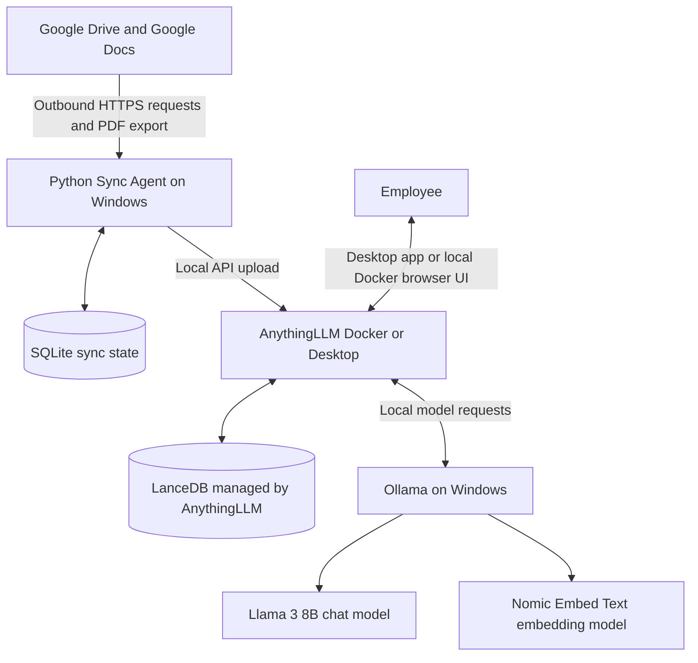

# Installation & Setup Guide — Secure Local RAG

> **This guide walks you through installing and running the project from scratch on Windows.** Follow the sections in order. Complete each verification check before moving to the next section.
>
> **V1 scope:** one user on one Windows computer, one Google Drive folder tree (including subfolders), and Google Docs only.

## Before you begin: what are we installing?



### Important privacy boundary

The embedding, retrieval, and answer-generation workloads are intended to run locally. However, Google Drive remains a cloud service: the Python Sync Agent connects to Google over the internet to list file metadata and export Google Docs. This is **not an air-gapped system**. A precise description is **local AI processing and inference with outbound Google Drive synchronization**.

Initial software installation, model downloads, software updates, and Google Drive synchronization also require internet access.

---

## 1. Download the project and check its files

After downloading and extracting the repository, the project folder should look similar to this:

```text
C:\SecureLocalRAG\
├── README.md
├── SETUP.md
├── SETUP_AR.md
├── PROJECT_SCOPE.md
├── .gitignore
│
├── sync_agent\
│   ├── sync_agent.py
│   ├── requirements.txt
│   ├── .env.example
│   ├── start_sync.bat
│   │
│   │   # Created locally during setup (never commit):
│   ├── credentials.json
│   ├── .env
│   ├── .venv\
│   ├── data\
│   ├── logs\
│   └── tmp\
│
├── anythingllm_data\   # Created locally for Docker deployment only
└── models\             # Optional: custom Modelfiles or manual model backups
```

The `.env` and `credentials.json` files inside `sync_agent/` are private local files. They must **not** be committed to GitHub. The `.env.example` file is safe to commit because it contains placeholders only. The `anythingllm_data/` folder is created locally only when using Docker. AnythingLLM Desktop manages its own storage.

> **Storage notes:**
> - **`anythingllm_data/`** is for Docker persistent storage. If you use AnythingLLM Desktop, you do not need this folder; Desktop stores its data in `%APPDATA%\anythingllm-desktop\storage` by default; see the [official Desktop storage documentation](https://docs.anythingllm.com/installation-desktop/storage).
> - **`models/`** is optional. It can hold custom `Modelfile` definitions or manual backups, but it does not change Ollama's default model location (`%USERPROFILE%\.ollama\models`). To change Ollama's model storage path, configure `OLLAMA_MODELS` explicitly in Windows.

### Download the repository

1. Open the project repository on GitHub.
2. Select **Code → Download ZIP**.
3. Extract the ZIP file to `C:\SecureLocalRAG`.
4. Open `C:\SecureLocalRAG\sync_agent` and confirm that `sync_agent.py`, `requirements.txt`, `.env.example`, and `start_sync.bat` are present.

> Keep `sync_agent.py`, `requirements.txt`, `.env.example`, `.env`, `credentials.json`, and `.venv/` together inside `sync_agent/`. The script resolves relative paths from its own location (`BASE_DIR`), so the data, logs, and temporary export files will also stay inside this folder.

## 2. Install Docker Desktop (Docker deployment only)

Docker is the primary deployment path in this guide. If you prefer the single-user AnythingLLM Desktop alternative, skip this entire section and follow **Section 4.5** instead. Ollama and the Python Sync Agent run directly on Windows in either deployment path.

### 2.1 Check Windows and virtualization

1. Press **Start**, type `winver`, and check your Windows version.
2. Review Docker's current [Windows installation requirements](https://docs.docker.com/desktop/setup/install/windows-install/).
3. Docker Desktop uses WSL 2 by default for most Windows installations. Hardware virtualization must be enabled in BIOS/UEFI.
4. Open PowerShell and check WSL:

```powershell
wsl --version
```

5. If WSL is not installed, follow Microsoft's [WSL installation guide](https://learn.microsoft.com/windows/wsl/install). Then restart Windows if requested.
6. Update WSL:

```powershell
wsl --update
```

**Windows support note:** Windows 10 reached its general end-of-support date on October 14, 2025. Prefer a currently supported Windows 11 release for a new installation. If you plan to use Windows 10, verify that your exact Windows edition and servicing/ESU status are still supported by both Microsoft and the current Docker Desktop requirements. Microsoft explains the end-of-support date and ESU options [here](https://support.microsoft.com/en-us/windows/deployment/updates-lifecycle/windows-10-support-has-ended-on-october-14-2025). Docker's current WSL 2 requirements specify WSL 2.1.5 or later and list supported Windows editions/releases; check the official page before installing.

### 2.2 Install Docker Desktop

1. Download [Docker Desktop for Windows](https://www.docker.com/products/docker-desktop/).
2. Run the installer.
3. Select the **WSL 2** backend when prompted, unless your environment requires another supported backend.
4. Finish the installation and restart Windows if requested.
5. Open Docker Desktop from the Start menu.
6. Accept the Docker terms and wait until Docker Desktop reports that the engine is running.
7. Make sure Docker is using **Linux containers**.

> **Commercial licensing:** Docker Desktop commercial use in larger organizations may require a paid subscription. Docker currently specifies a paid subscription for organizations with **more than 250 employees OR more than USD 10 million in annual revenue**. Review Docker's [current terms and installation documentation](https://docs.docker.com/desktop/setup/install/windows-install/) before using it at work.

### 2.3 Verify Docker

Open a new PowerShell window and run:

```powershell
docker version
docker info --format '{{.OSType}}'
```

The second command should print:

```text
linux
```

If Docker reports that it cannot connect to the daemon, open Docker Desktop and wait until startup has completed.

---

## 3. Install Ollama and download the models

Ollama runs the language and embedding models locally on the Windows host.

### 3.1 Install Ollama

1. Download [Ollama for Windows](https://ollama.com/download/windows).
2. Run the installer.
3. Open a new PowerShell window.
4. Verify that the command is available:

```powershell
ollama --version
```

Ollama normally starts its local service automatically after installation.

### 3.2 Download the two models

Download the chat model:

```powershell
ollama pull llama3:8b
```

Download the embedding model:

```powershell
ollama pull nomic-embed-text
```

Check that both models are installed:

```powershell
ollama list
```

You should see `llama3:8b` and `nomic-embed-text` in the list.

### 3.3 Verify the Ollama service

Open this address in your browser:

[http://127.0.0.1:11434](http://127.0.0.1:11434)

You should see a message indicating that Ollama is running. If the page does not respond, open the Ollama application from the Start menu. If needed, start the service in a separate PowerShell window with:

```powershell
ollama serve
```

### 3.4 Check GPU usage

If you have an NVIDIA GPU, run:

```powershell
nvidia-smi
ollama ps
```

`nvidia-smi` displays GPU memory usage. `ollama ps` displays models currently loaded by Ollama. Run these checks while a model is actively answering a question.

> An NVIDIA RTX 3070 with 8 GB of VRAM is a reasonable starting point for testing an 8B quantized model, but actual performance depends on context length, model quantization, available system RAM, and other GPU workloads. Downloading a model does not guarantee that the entire model and its context will fit in VRAM. Test with real questions before relying on it.

---

## 4. Run AnythingLLM (Docker primary path or Desktop alternative)

> **Choose one deployment:**
> - **AnythingLLM Docker — primary path in this guide:** provides a browser-accessible UI, persistent storage at a location you control, container restart behavior, and instance password protection. It is the better path if you may later evolve the project beyond one personal workstation.
> - **AnythingLLM Desktop — single-user alternative:** easier to install for personal use on one Windows computer. It does not provide Docker-style multi-user management, instance password protection, or a browser UI. Its developer API is available locally. Do not enable Network Discovery just to let a Python script on the same computer call the API; keep the backend bound to loopback.

### 4.1 Create the persistent storage folder (Docker)

Run these commands in PowerShell:

```powershell
$storage = 'C:\SecureLocalRAG\anythingllm_data'
New-Item -ItemType Directory -Force -Path $storage | Out-Null

$anythingEnv = Join-Path $storage '.env'
if (-not (Test-Path $anythingEnv)) {
    New-Item -ItemType File -Path $anythingEnv | Out-Null
}
```

This folder keeps AnythingLLM data on the Windows host when the container is recreated.

> There will be **two different `.env` files** in the Docker setup:
> - `C:\SecureLocalRAG\anythingllm_data\.env` belongs to the AnythingLLM Docker container.
> - `C:\SecureLocalRAG\sync_agent\.env` belongs to the Python Sync Agent.
> Do not mix these files.

> **Moving an existing Docker installation:** If your existing container uses `C:\anythingllm_data`, stop it before copying its data. For example:
> ```powershell
> docker stop anythingllm
> robocopy C:\anythingllm_data C:\SecureLocalRAG\anythingllm_data /E /COPY:DAT /R:2 /W:2
> ```
> After verifying the copied files, remove only the old container (`docker rm anythingllm`) and recreate it with the command below. Do not delete the old storage folder until the new container starts and your workspaces/documents are visible. If you have never used Docker AnythingLLM before, skip this migration note.

### 4.2 Download the AnythingLLM image (Docker)

```powershell
docker pull mintplexlabs/anythingllm:latest
```

**Security version check:** Do not deploy AnythingLLM **v1.16.1**. The published advisory marks v1.16.1 as affected and versions newer than 1.16.1 as patched. Use a current patched release and check the [official security advisory](https://github.com/Mintplex-Labs/anything-llm/security/advisories/GHSA-3f4c-xj8r-h4cr) and release notes before deployment. For a business-critical setup, record and pin the exact image version or digest you tested rather than relying indefinitely on the floating `latest` tag.

### 4.3 Start the Docker container

Run this command in PowerShell. Keep the backtick character (`` ` ``) at the end of each continued line:

```powershell
docker run -d --name anythingllm --restart unless-stopped `
  -p 127.0.0.1:3001:3001 `
  --cap-add SYS_ADMIN `
  -v "C:\SecureLocalRAG\anythingllm_data:/app/server/storage" `
  -v "C:\SecureLocalRAG\anythingllm_data\.env:/app/server/.env" `
  -e STORAGE_DIR=/app/server/storage `
  mintplexlabs/anythingllm:latest
```

Why these options are used:
- `--name anythingllm` gives the container a predictable name.
- `--restart unless-stopped` allows Docker to restart it after Docker Engine restarts unless you explicitly stopped it.
- `-p 127.0.0.1:3001:3001` binds the web UI to the local computer only for V1.
- The storage volume keeps AnythingLLM data under `C:\SecureLocalRAG\anythingllm_data`.
- `SYS_ADMIN` is included in the current official AnythingLLM Docker example. It is a broad Linux capability; keep the documented baseline for the initial supported setup. If you remove it, test startup, PDF processing, embedding, and restart behavior in a disposable environment before changing the working deployment.

### 4.4 Verify the Docker container

Run:

```powershell
docker ps
docker logs --tail 50 anythingllm
```

You should see a container named `anythingllm` with a status similar to `Up`. Open the web interface at [http://localhost:3001](http://localhost:3001). Do not continue until the page loads successfully.

### 4.5 Install AnythingLLM Desktop (alternative)

Use this route only if you choose Desktop instead of Docker:

1. Download the current [AnythingLLM Desktop for Windows](https://docs.anythingllm.com/installation-desktop/windows).
2. Install it for **Current User** rather than all Windows users, as recommended by AnythingLLM.
3. Launch AnythingLLM from the Start menu and complete its first-run setup.
4. Keep Network Discovery **off**. By default, the Desktop backend listens on `127.0.0.1`; a script running on the same computer can use the local API without exposing it to the LAN.
5. Record the local Developer API base address/port shown by your installed Desktop version. Do not assume the Docker address `http://127.0.0.1:3001/api/v1` is the correct Desktop address. You will enter the Desktop address in `sync_agent/.env` in Section 7.

Desktop does not provide a browser-accessible UI, instance password protection, or multi-user support. Do not enable Network Discovery or expose the Desktop API to the public internet. See the [official Desktop overview](https://docs.anythingllm.com/installation-desktop/overview).

## 5. Configure AnythingLLM and connect it to Ollama

Complete the initial setup in the Docker browser UI or in the AnythingLLM Desktop app, depending on the deployment you selected in Section 4.

### 5.1 Set up single-user access

- **Docker:** keep the instance in **Single-user Mode** for V1, enable **Password Protect Instance**, and set a strong password.
- **Desktop:** it is a local single-user application and does not provide Docker-style instance password protection or multi-user management. Keep Network Discovery off.

The wording or location of settings can change slightly between releases. See the official [Security and Access documentation](https://docs.anythingllm.com/features/security-and-access).

### 5.2 Configure the chat model

1. Open the AI provider or LLM settings.
2. Select **Ollama** as the chat/LLM provider.
3. Enter the Ollama URL that matches your AnythingLLM deployment:
   - **Docker:** `http://host.docker.internal:11434`
   - **Desktop:** `http://127.0.0.1:11434`
4. Select `llama3:8b` as the chat model.
5. Save the setting.

### 5.3 Configure the embedding model

1. Open the embedding provider settings and select **Ollama**.
2. Use the same Ollama URL selected in Section 5.2 (Docker: `http://host.docker.internal:11434`; Desktop: `http://127.0.0.1:11434`).
3. Select `nomic-embed-text` as the embedding model and save.
4. If AnythingLLM asks you to choose a vector database, keep its local default or select **LanceDB** if shown. Do not install LanceDB as a separate service.

### Important: the local connection URLs are deployment-specific

| Connection | URL | Why |
|---|---|---|
| AnythingLLM in Docker → Ollama on Windows | `http://host.docker.internal:11434` | Docker container reaches a service running on the Windows host |
| AnythingLLM Desktop → Ollama on the same Windows computer | `http://127.0.0.1:11434` | Both applications run on the same host |
| Python Sync Agent → AnythingLLM Docker API | `http://127.0.0.1:3001/api/v1` | Python runs on Windows and calls the locally bound Docker port |
| Python Sync Agent → AnythingLLM Desktop API | Use `http://127.0.0.1:<DESKTOP_PORT>/api/v1` with the port confirmed in your installed Desktop version | Desktop has its own local backend; do not guess the port |

Do not use `localhost` or `127.0.0.1` for the Ollama URL **inside Dockerized AnythingLLM**; those addresses refer to the container itself. See [AnythingLLM's Ollama connection troubleshooting guide](https://docs.anythingllm.com/ollama-connection-troubleshooting). Desktop runs directly on Windows, so its Ollama URL is the local loopback address.

### 5.4 Create a Workspace

1. Create a new Workspace.
2. Give it a simple name, for example `company-documents`.
3. Record the exact workspace slug if the interface shows it separately from the display name.

### 5.5 Create an API key

1. Open **Developer API** in AnythingLLM settings.
2. Generate a new API key and store it securely. Anyone holding this key may use the API with the permissions associated with it; never publish or share it.
3. For Docker, open the local API docs at [http://localhost:3001/api/docs](http://localhost:3001/api/docs).
4. For Desktop, use the local Developer API documentation/address shown by the installed Desktop version or its startup logs. Record the local host and port; do not reuse the Docker port unless it is confirmed for your version.

See the official [API Access & Keys documentation](https://docs.useanything.com/features/api).

### 5.6 Confirm the Workspace slug

AnythingLLM generally derives a workspace slug from its name by converting it to lowercase and replacing spaces with hyphens. For example, `Stayhub Docs` commonly becomes `stayhub-docs`, and `Company Documents` commonly becomes `company-documents`. Treat this as a quick estimate, not proof; copy the exact value when available.

To verify the exact slug via the API (recommended):
1. Open the local AnythingLLM API documentation for your deployment (Docker: `http://localhost:3001/api/docs`; Desktop: use the local API documentation address shown by your Desktop version).
2. Find `GET /v1/workspaces`.
3. Use **Try it out** and **Execute**, authorizing with your API key if requested.
4. Find your Workspace and copy its `slug` exactly.
5. Enter that value as `WORKSPACE_SLUG` in `sync_agent/.env` in Section 7.

Never share screenshots or API responses that expose your API key.

## 6. Configure Google Drive access

The Python agent uses a Google service account with read-only Drive access. You will share the target folder with this account.

### 6.1 Create a Google Cloud project and enable the Drive API

1. Open the [Google Cloud Console](https://console.cloud.google.com/).
2. Create a new project, or select an existing project.
3. Open the [Google Drive API page](https://console.cloud.google.com/apis/library/drive.googleapis.com).
4. Select **Enable**.

### 6.2 Create a service account

1. In Google Cloud Console, open **IAM & Admin → Service Accounts**.
2. Select **Create Service Account**.
3. Give it a recognizable name, for example `gdrive-rag-reader`.
4. Complete the creation process. You do not need to grant a broad project role just to read a Drive folder that you explicitly share with this account.
5. In the **Service Accounts** list, click directly on the blue email address of the new service account (ending in `.iam.gserviceaccount.com`) to open its individual details page. The **Keys** option is not necessarily visible from the main list.
6. On the top navigation bar, select **Keys**.
7. Click **Add key → Create new key**, select **JSON**, and click **Create**.
8. Google downloads a JSON file with an automatically generated name. Move it into `C:\SecureLocalRAG\sync_agent\` and rename it exactly to `credentials.json`.

> Keep this file private. It contains a private service-account key. Never commit it to GitHub or send it in a chat, issue, or log. Some Google Workspace or Cloud organizations prohibit service-account key creation or external sharing; if blocked, ask the administrator for an approved method rather than bypassing policy.

### 6.3 Share the target Drive folder with the service account

1. Open the service account details page and copy its email address. It usually ends with:

```text
.iam.gserviceaccount.com
```

2. Open Google Drive using your normal account.
3. Right-click the **top-level folder** you want to synchronize.
4. Select **Share**.
5. Paste the service account email address.
6. Set its role to **Viewer** only.
7. Save the sharing settings.

The service account must be able to see the root folder and the nested folders that should be synchronized. If you use a Shared Drive, make sure the service account has the appropriate read-only membership/access on that Shared Drive. Organization sharing policies may restrict this.

### 6.4 Copy the Google Drive Folder ID

Open the top-level folder in your browser. Its URL will look similar to:

```text
https://drive.google.com/drive/folders/1AbCDefGhijkLMNopQRstuVWxyz
```

Copy only the value after `/folders/`. This is the `DRIVE_FOLDER_ID`.

The project folder should now contain:

```text
C:\SecureLocalRAG\sync_agent\credentials.json
```

**Never commit `credentials.json` to GitHub or send it to anyone.** It contains a private service-account key.

---

## 7. Set up the Python Sync Agent

All Python Sync Agent files are now grouped in `C:\SecureLocalRAG\sync_agent`. Run the following commands from that folder.

### 7.1 Open Command Prompt in the `sync_agent` folder

Open File Explorer and navigate to `C:\SecureLocalRAG\sync_agent`. Click the address bar, type `cmd`, and press **Enter**. Alternatively, open Command Prompt and run:

```cmd
cd /d C:\SecureLocalRAG\sync_agent
```

Check that Python 3.10 or newer is available through the Windows Python launcher:

```cmd
py -3 --version
```

If Python is not found, install it from [python.org](https://www.python.org/downloads/windows/), then open a new terminal window.

### 7.2 Create a virtual environment and install dependencies

Run these commands in order inside `C:\SecureLocalRAG\sync_agent`:

```cmd
py -3 -m venv .venv
.venv\Scripts\python.exe -m pip install --upgrade pip
.venv\Scripts\python.exe -m pip install -r requirements.txt
```

This uses the Python executable inside `.venv` directly. You do not need to activate the environment, change PowerShell execution policies, or rely on the global `pip` command.

### 7.3 Create the Python configuration file

Copy the example configuration and open the new file:

```cmd
copy .env.example .env
notepad .env
```

> **Windows hidden file extension warning:** Use the copy command above. If you create `.env` manually with **Right-click → New → Text Document**, Windows may leave the name as `New Text Document.env` or `.env.txt`. The file must be named exactly `.env`.

Replace the placeholders in `.env` with your own values:

```dotenv
# Google Drive
GOOGLE_CREDENTIALS_FILE=credentials.json
DRIVE_FOLDER_ID=PASTE_GOOGLE_DRIVE_FOLDER_ID_HERE

# AnythingLLM API - Docker default
ANYTHINGLLM_BASE_URL=http://127.0.0.1:3001/api/v1
ANYTHINGLLM_API_KEY=PASTE_ANYTHINGLLM_API_KEY_HERE
WORKSPACE_SLUG=company-documents

# Sync interval in minutes
CHECK_INTERVAL_MINUTES=15

# Paths relative to this sync_agent folder
STATE_DB_PATH=./data/sync_state.sqlite3
LOG_PATH=./logs/sync_agent.log
TEMP_DIR=./tmp
```

Save the file and close Notepad. For AnythingLLM Desktop, replace `ANYTHINGLLM_BASE_URL` with the local API base URL and port confirmed for your installed Desktop version, in the form `http://127.0.0.1:<DESKTOP_PORT>/api/v1`. Do not assume `3001` is the Desktop port.

Check these values carefully:
- `GOOGLE_CREDENTIALS_FILE`: `credentials.json` must be beside `sync_agent.py` in this folder, unless you set an explicit alternate path.
- `DRIVE_FOLDER_ID`: enter only the folder ID after `/folders/`, not the full URL.
- `ANYTHINGLLM_BASE_URL`: use `http://127.0.0.1:3001/api/v1` for the Docker setup; use the exact local API address confirmed for Desktop.
- `ANYTHINGLLM_API_KEY`: paste the key generated in AnythingLLM.
- `WORKSPACE_SLUG`: use the exact slug verified in Section 5.6.

### 7.4 Check `.gitignore` and protect secrets

The repository `.gitignore` at `C:\SecureLocalRAG\.gitignore` should include at least:

```gitignore
.env
**/.env
credentials.json
**/credentials.json
.venv/
sync_agent/.venv/
sync_agent/data/
sync_agent/logs/
sync_agent/tmp/
anythingllm_data/
__pycache__/
**/__pycache__/
*.py[cod]
```

Commit `sync_agent/.env.example`, but never commit `sync_agent/.env` or `sync_agent/credentials.json`.

## 8. Run the Sync Agent for the first time

Before starting, confirm that:
- AnythingLLM is running (Docker container or Desktop app).
- Ollama is running on Windows.
- AnythingLLM can connect to the chat and embedding models. For Docker use `host.docker.internal`; for Desktop use `127.0.0.1`.
- You created the Workspace and configured the correct API key, API base URL, and slug in `sync_agent/.env`.
- The Google Drive folder is shared with the service account email (`...iam.gserviceaccount.com`) as **Viewer**.
- `C:\SecureLocalRAG\sync_agent\` contains `.env` and `credentials.json`.

You can start the Sync Agent using either method:

**Option A — Double-click launcher:**

Open `C:\SecureLocalRAG\sync_agent` in File Explorer and double-click `start_sync.bat`.

**Option B — Command line:**

```cmd
cd /d C:\SecureLocalRAG\sync_agent
.venv\Scripts\python.exe sync_agent.py
```

During synchronization, the agent validates its settings, scans the Drive folder tree, exports new or modified Google Docs to PDF, uploads them to AnythingLLM, and records state in `sync_agent\data\sync_state.sqlite3` and logs in `sync_agent\logs\sync_agent.log`. Temporary exports are stored under `sync_agent\tmp\` and cleaned after processing.

**Keep the terminal window open.** Closing it or pressing `Ctrl+C` stops synchronization. Do not run multiple instances of `sync_agent.py` at the same time.

> **Note on Arabic filenames in Windows Terminal / CMD:** Arabic document titles may appear reversed or disconnected in the terminal output. This is a display issue and does not change the PDF content or AnythingLLM retrieval.

### Where are the local state and logs stored?

The agent creates these files and folders automatically relative to `sync_agent.py`:

```text
sync_agent\data\sync_state.sqlite3
sync_agent\logs\sync_agent.log
sync_agent\tmp\
```

## 9. Test the system before relying on it

Start with a small test folder containing one or two Google Docs. Do not point the first test at the full company folder.

| Test | What to do | Expected result |
|---|---|---|
| New document | Create a Google Doc in the shared folder | The agent detects it, uploads it, and it becomes searchable in the Workspace |
| Nested folder | Create a subfolder and place a Google Doc inside it | The agent discovers and indexes the nested document |
| Unchanged document | Wait for another sync cycle without editing the document | The agent skips unnecessary download/upload work |
| Edited document | Add a unique test sentence to an existing Google Doc | The next sync cycle updates the indexed content; a question about the new sentence can retrieve it |
| Deleted document | Delete the test document from the configured Drive folder | The agent removes its association from the Workspace after a complete successful Drive scan |
| Restart the agent | Stop it with `Ctrl+C`, then start it again | The agent reads SQLite and does not treat all existing documents as new |

After each test, review:

```text
sync_agent/logs/sync_agent.log
```

Then open the AnythingLLM interface you selected (the Desktop app, or the Docker browser UI at [http://localhost:3001](http://localhost:3001)) and ask a question whose answer is clearly stated in the test document. Check whether the relevant source/document appears in the answer details, depending on the UI version.

> **Deletion behavior:** This V1 process removes a deleted document from the active Workspace. It does not necessarily delete the file permanently from AnythingLLM's global document library or every local storage location. Do not treat Workspace removal as permanent erasure or as compliance-grade data deletion. A separate global deletion workflow would need to be designed and tested.

### Known Google Docs export limit

The Google Drive API `files.export` method currently limits exported content to **10 MB**. A Google Doc that exceeds the export limit may fail to synchronize. See Google's [Export Google Workspace documents documentation](https://developers.google.com/workspace/drive/api/reference/rest/v3/files/export) and [Download and export files guide](https://developers.google.com/workspace/drive/api/guides/manage-downloads).

---

## 10. Daily operation and shutdown

### Start the system after turning on the computer

1. **Docker path:** Open Docker Desktop and wait until its engine is running. Check the UI at [http://localhost:3001](http://localhost:3001); the container should restart automatically unless you previously stopped it. **Desktop path:** Launch the AnythingLLM Desktop app from the Start menu.
2. Make sure Ollama is running. It normally starts automatically with Windows.
3. Open File Explorer to `C:\SecureLocalRAG\sync_agent` and double-click `start_sync.bat`, or open Command Prompt in that folder and run:

```cmd
.venv\Scripts\python.exe sync_agent.py
```

### Stop synchronization

Press `Ctrl+C` in the terminal window running the Sync Agent. Close the AnythingLLM Desktop app only after stopping the agent if you are using the Desktop path.

### Check the AnythingLLM container (Docker only)

```powershell
docker ps
docker logs --tail 100 anythingllm
```

For Desktop, open the app and check its local Developer API documentation/logs instead of using Docker commands.

### Start AnythingLLM if the container is stopped

```powershell
docker start anythingllm
```

Do not delete `C:\SecureLocalRAG\anythingllm_data` when using Docker. It contains AnythingLLM's local storage and database. Desktop manages its storage separately.

---

## 11. Troubleshooting

| Problem | What to check |
|---|---|
| `docker` command is not recognized | Confirm Docker Desktop is installed, then open a new PowerShell window |
| Docker engine is not running | Open Docker Desktop; check WSL 2, Windows support, and hardware virtualization |
| `localhost:3001` does not open (Docker) | Run `docker ps` and `docker logs --tail 100 anythingllm`; for Desktop, launch the app directly instead of using a browser URL |
| AnythingLLM cannot see Ollama models | For Docker, use `http://host.docker.internal:11434`; for Desktop, use `http://127.0.0.1:11434`; confirm Ollama is running on Windows |
| Ollama does not respond | Open `http://127.0.0.1:11434` or start the Ollama app |
| A model does not appear in AnythingLLM | Run `ollama list`, verify the exact model tag, and re-save the provider settings |
| Google returns `403` or `404` | Check that Drive API is enabled, the Folder ID is correct, and the service account has Viewer access to the folder |
| AnythingLLM returns `401` | Generate a new API key and update `ANYTHINGLLM_API_KEY` in the Python `.env` file |
| Workspace not found | Check `WORKSPACE_SLUG` against the actual slug returned by the AnythingLLM API |
| Python reports a missing package | From `C:\SecureLocalRAG\sync_agent`, run `.venv\Scripts\python.exe -m pip install -r requirements.txt` |
| The Sync Agent exits immediately | Check the first error in `sync_agent\logs\sync_agent.log`; confirm no `PASTE_...` placeholders remain in `sync_agent\.env` |
| `'pip' is not recognized` in CMD | Use the virtual-environment interpreter directly: `.venv\Scripts\python.exe -m pip install -r requirements.txt` (from `sync_agent`) |
| `RuntimeError: Configured DRIVE_FOLDER_ID is not an accessible, active folder` | Share the root Drive folder with the service-account email as **Viewer**; confirm `DRIVE_FOLDER_ID` contains only the ID after `/folders/`, without spaces or the full URL |
| `Missing .env settings` or `.env` appears ignored | Confirm the file is exactly `sync_agent\.env` (not `New Text Document.env` or `.env.txt`) and that required values in it are filled in |
| Desktop API connection fails | Confirm the actual local Desktop API host/port and base path for your installed version; keep Network Discovery off when the Sync Agent is on the same computer |
| A Google Doc fails during PDF export | Check whether the document exceeds the Drive API export size limit and whether the service account can view it |
| GPU memory is full | Check `nvidia-smi` and `ollama ps`; reduce context length or test a smaller model if necessary |

---

## 12. Security and backups

Follow these rules even during testing:

- Never commit `.env` or `credentials.json` to GitHub.
- Never share the AnythingLLM API key or the service-account private key.
- **Docker:** keep the port bound to `127.0.0.1`; do not change it to `0.0.0.0` or `3001:3001`. Keep Single-user Mode and instance password protection enabled.
- **Desktop:** leave Network Discovery off. Desktop has no instance password protection or multi-user access; do not expose its API to the LAN or public internet.
- Give the Google service account **Viewer** access only.
- Do not configure a hosted/cloud LLM or embedding provider if the requirement is to keep embeddings and inference local.
- Remember that synchronization still sends outbound requests to Google Drive over the internet.
- Review the Docker and AnythingLLM security advisories before updating the deployment.

### What should be backed up?

1. The complete `C:\SecureLocalRAG\anythingllm_data` folder for Docker, or `%APPDATA%\anythingllm-desktop\storage` for Desktop. Quit AnythingLLM Desktop before copying its storage folder; see the [official storage guide](https://docs.anythingllm.com/installation-desktop/storage).
2. `C:\SecureLocalRAG\sync_agent\data\sync_state.sqlite3`.
3. A secure, encrypted copy of `C:\SecureLocalRAG\sync_agent\.env` and `C:\SecureLocalRAG\sync_agent\credentials.json`, handled according to your organization's credential policy. Alternatively, rotate/recreate credentials when required.

Do not delete the SQLite database as a troubleshooting shortcut. The agent uses it to remember which documents have already been synchronized. Removing it can cause previously indexed documents to be processed again.

---

## 13. What we are deliberately not adding to V1

To keep the first version small and maintainable, it does not require:

- Redis, Kafka, Kubernetes, or PostgreSQL.
- A separately managed LanceDB service.
- PDF uploads, Google Sheets, Word documents, or other file sources.
- Access from other computers on the network.
- A reverse proxy or internal HTTPS setup before multi-device access is actually required.
- A Windows Service before the basic synchronization workflow has been tested.

After the single-user pilot is successful, consider a dedicated always-on company workstation, multi-user access, additional data sources, and a managed startup process as separate improvements.

---

## Official downloads and documentation

### Core software

- [Docker Desktop for Windows](https://www.docker.com/products/docker-desktop/)
- [AnythingLLM Desktop for Windows](https://docs.anythingllm.com/installation-desktop/windows)
- [Docker Desktop — Windows installation requirements](https://docs.docker.com/desktop/setup/install/windows-install/)
- [Microsoft — Install WSL](https://learn.microsoft.com/windows/wsl/install)
- [Ollama for Windows](https://ollama.com/download/windows)
- [Ollama — Llama 3 model](https://ollama.com/library/llama3)
- [Ollama — Nomic Embed Text model](https://ollama.com/library/nomic-embed-text)
- [Python for Windows](https://www.python.org/downloads/windows/)

### AnythingLLM

- [AnythingLLM — Docker Quickstart](https://docs.anythingllm.com/installation-docker/quickstart)
- [AnythingLLM — Local Docker installation](https://docs.anythingllm.com/installation-docker/local-docker)
- [AnythingLLM — Desktop installation overview](https://docs.anythingllm.com/installation-desktop/overview)
- [AnythingLLM — Ollama/Docker troubleshooting](https://docs.anythingllm.com/ollama-connection-troubleshooting)
- [AnythingLLM — API Access & Keys](https://docs.useanything.com/features/api)
- [AnythingLLM — Security and Access](https://docs.anythingllm.com/features/security-and-access)
- [AnythingLLM — Security advisory for v1.16.1](https://github.com/Mintplex-Labs/anything-llm/security/advisories/GHSA-3f4c-xj8r-h4cr)

### Google Drive

- [Google Cloud Console](https://console.cloud.google.com/)
- [Google Drive API](https://console.cloud.google.com/apis/library/drive.googleapis.com)
- [Google Cloud — Create service accounts](https://cloud.google.com/iam/docs/service-accounts-create)
- [Google Cloud — Create and manage service-account keys](https://cloud.google.com/iam/docs/keys-create-delete)
- [Google Drive API — files.list](https://developers.google.com/workspace/drive/api/reference/rest/v3/files/list)
- [Google Drive API — files.export](https://developers.google.com/workspace/drive/api/reference/rest/v3/files/export)
- [Google Drive API — Download and export files](https://developers.google.com/workspace/drive/api/guides/manage-downloads)
- [Google Drive Help — Share files and folders](https://support.google.com/drive/answer/7166529)

---

**Guide status:** Windows-first setup instructions for the single-user V1 pilot. Complete the tests in Section 9 before using the system with real company documents.
