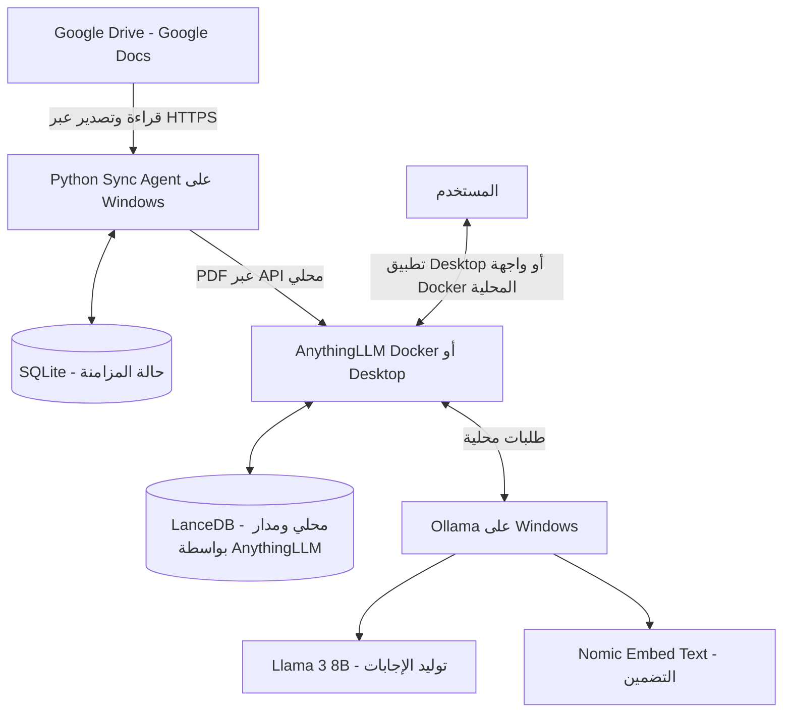

# دليل الإعداد والتشغيل — Secure Local RAG

> **هذا الملف هو دليل التنفيذ العملي للمشروع من الصفر على Windows.** اتبع الخطوات بالترتيب. لا تنتقل إلى المرحلة التالية قبل نجاح اختبار المرحلة الحالية.
>
> نطاق هذا الإصدار: مستخدم واحد على جهاز Windows واحد، ومجلد Google Drive واحد يشمل المجلدات الفرعية، وملفات Google Docs فقط.

---

## قبل أن تبدأ: ما الذي سنشغّله؟



**مهم بشأن الخصوصية:** النماذج والتضمين والبحث وتوليد الإجابات تعمل محليًا. لكن Google Drive يبقى خدمة سحابية؛ يتصل به Python Sync Agent عبر الإنترنت لجلب بيانات الملفات وتصدير المستندات. لذلك هذا المشروع ليس جهازًا معزولًا عن الإنترنت (Air-gapped)، بل نظام استدلال محلي مع مزامنة سحابية صادرة.

## 1. تأكد من وجود ملفات المشروع

بعد تنزيل المشروع من GitHub وفك ضغطه، يجب أن يكون هيكله قريبًا من التالي:

```text
C:\SecureLocalRAG\
├── README.md
├── SETUP.md
├── SETUP_AR.md
├── PROJECT_SCOPE.md
├── .gitignore
│
├── sync_agent\
│   ├── sync_agent.py
│   ├── requirements.txt
│   ├── .env.example
│   ├── start_sync.bat
│   │
│   │   # تُنشأ محليًا أثناء الإعداد ولا تُرفع إلى GitHub:
│   ├── credentials.json
│   ├── .env
│   ├── .venv\
│   ├── data\
│   ├── logs\
│   └── tmp\
│
├── anythingllm_data\   # يُنشأ محليًا عند استخدام Docker فقط
└── models\             # اختياري: ملفات Modelfile أو نسخ احتياطية يدوية
```

ملفا `sync_agent/.env` و`sync_agent/credentials.json` يحتويان على أسرار خاصة، لذلك لا ترفعهما إلى GitHub. أما `.env.example` فهو آمن للرفع لأنه يحتوي على قيم توضيحية فقط. مجلد `anythingllm_data/` يُنشأ محليًا عند استخدام Docker؛ نسخة Desktop تدير ملفاتها بنفسها.

> **ملاحظات التخزين:**
> - **`anythingllm_data/`**: مخصص لتخزين Docker. عند استخدام AnythingLLM Desktop لا تحتاج إلى هذا المجلد؛ إذ يحفظ Desktop بياناته افتراضيًا في `%APPDATA%\anythingllm-desktop\storage`؛ راجع [وثائق التخزين الرسمية لنسخة Desktop](https://docs.anythingllm.com/installation-desktop/storage).
> - **`models/`**: مجلد اختياري لحفظ ملفات `Modelfile` المخصصة أو النسخ الاحتياطية يدويًا. وجوده لا يغيّر مسار تخزين Ollama الافتراضي (`%USERPROFILE%\.ollama\models`). لتغيير المسار، اضبط متغير Windows باسم `OLLAMA_MODELS` بشكل صريح.

### تنزيل المشروع إلى جهازك

1. افتح مستودع المشروع على GitHub.
2. اضغط **Code** ثم **Download ZIP**.
3. فك الضغط في المسار `C:\SecureLocalRAG`.
4. افتح `C:\SecureLocalRAG\sync_agent` وتأكد من وجود `sync_agent.py` و`requirements.txt` و`.env.example` و`start_sync.bat`.

> اترك `sync_agent.py` و`requirements.txt` و`.env.example` وملف `.env` و`credentials.json` وبيئة `.venv/` معًا داخل `sync_agent/`. الكود يحدد موقعه باستخدام `BASE_DIR`، لذلك ستكون مجلدات البيانات والسجلات والملفات المؤقتة داخل هذا المجلد أيضًا.

## 2. ثبّت Docker Desktop (عند اختيار تشغيل Docker فقط)

Docker هو مسار التشغيل الأساسي المشروح في هذا الدليل. إذا اخترت بديل AnythingLLM Desktop للاستخدام الفردي، فتجاوز هذا القسم كاملًا واتبع القسم **4.5**. في كلا الخيارين سيعمل Ollama وPython مباشرة على Windows.

1. تحقق من إصدار Windows بكتابة `winver` في قائمة Start.
2. راجع [متطلبات Docker Desktop لويندوز](https://docs.docker.com/desktop/setup/install/windows-install/). يتطلب تشغيل Docker Desktop على Windows إعداد WSL 2 أو أحد المحركات المدعومة، مع تفعيل Virtualization من BIOS/UEFI عند الحاجة.
3. إذا كان WSL 2 مثبتًا، افتح PowerShell وشغّل:

```powershell
wsl --update
wsl --version
```

4. إذا لم يكن WSL مثبتًا، اتبع [دليل تثبيت WSL الرسمي](https://learn.microsoft.com/windows/wsl/install)، ثم أعد تشغيل الجهاز عند طلب ذلك.
5. نزّل وثبّت [Docker Desktop for Windows](https://www.docker.com/products/docker-desktop/).
6. افتح Docker Desktop وانتظر حتى تظهر حالة أنه يعمل. استخدم محرك **Linux containers**.

> **ترخيص الشركة:** راجع شروط Docker Desktop قبل استخدامه تجاريًا. تنص وثائق Docker الحالية على أن المؤسسات التي يزيد عدد موظفيها عن 250 أو تتجاوز إيراداتها السنوية 10 ملايين دولار تحتاج إلى اشتراك مدفوع. راجع شروط الترخيص الرسمية من صفحة [Docker Desktop](https://docs.docker.com/desktop/setup/install/windows-install/).

### اختبر Docker

افتح PowerShell جديدًا واكتب:

```powershell
docker version
docker info --format '{{.OSType}}'
```

يجب أن يعرض الأمر الثاني:

```text
linux
```

إذا ظهر خطأ اتصال، افتح Docker Desktop وانتظر حتى يكتمل التشغيل قبل المتابعة.

---

## 3. ثبّت Ollama وحمّل النموذجين

Ollama هو الذي يشغّل نماذج الذكاء الاصطناعي محليًا على جهازك.

1. نزّل Ollama من [الموقع الرسمي](https://ollama.com/download/windows).
2. ثبّته كأي برنامج Windows عادي.
3. افتح PowerShell جديدًا وتأكد من عمله:

```powershell
ollama --version
```

4. حمّل نموذج التضمين:

```powershell
ollama pull nomic-embed-text
```

5. حمّل نموذج المحادثة:

```powershell
ollama pull llama3:8b
```

6. تأكد من ظهور النموذجين:

```powershell
ollama list
```

يجب أن ترى `nomic-embed-text` و`llama3:8b` في القائمة.

### اختبر خدمة Ollama

افتح هذا العنوان في المتصفح:

[http://127.0.0.1:11434](http://127.0.0.1:11434)

يفترض أن تظهر رسالة تفيد بأن Ollama يعمل. غالبًا يبدأ Ollama تلقائيًا بعد التثبيت. إذا لم يعمل، افتح تطبيق Ollama من قائمة Start أو شغّل `ollama serve` في نافذة PowerShell منفصلة.

إذا كان لديك NVIDIA GPU، تحقق من تعريف البطاقة واستهلاك الذاكرة:

```powershell
nvidia-smi
ollama ps
```

> RTX 3070 بذاكرة 8GB مناسبة لاختبار نموذج 8B مكمّم، لكن الأداء والذاكرة المتاحة يعتمدان على طول السياق والبرامج الأخرى. لا تعتبر نجاح تنزيل النموذج ضمانًا بأنه سيعمل دائمًا بكامل طبقاته داخل VRAM؛ اختبره فعليًا.

---

## 4. شغّل AnythingLLM (Docker هو المسار الأساسي وDesktop بديل)

> **اختر طريقة تشغيل واحدة:**
> - **AnythingLLM Docker — المسار الأساسي في هذا الدليل:** يوفر واجهة عبر المتصفح، وتحكمًا في مسار التخزين، وإعادة تشغيل الحاوية، وحماية كلمة مرور للنسخة. وهو الأنسب إذا أردت توسيع المشروع لاحقًا.
> - **AnythingLLM Desktop — بديل للاستخدام الفردي:** أسهل في التثبيت على جهاز Windows واحد، لكنه لا يوفر إدارة متعددة المستخدمين أو حماية كلمة مرور للنسخة مثل Docker، ولا يقدم واجهة عبر المتصفح. يوفر Developer API محليًا. لا تفعّل Network Discovery لمجرد أن سكريبت Python على نفس الجهاز يحتاج إلى API؛ اترك الاتصال على loopback.

### 4.1 أنشئ مجلد التخزين الدائم (Docker)

نفّذ الأوامر التالية في PowerShell:

```powershell
$storage = 'C:\SecureLocalRAG\anythingllm_data'
New-Item -ItemType Directory -Force -Path $storage | Out-Null

$anythingEnv = Join-Path $storage '.env'
if (-not (Test-Path $anythingEnv)) {
    New-Item -ItemType File -Path $anythingEnv | Out-Null
}
```

يحفظ هذا المجلد بيانات AnythingLLM على جهاز Windows حتى لا تضيع عند إعادة إنشاء الحاوية.

> سيكون هناك **ملفا `.env` مختلفان** عند استخدام Docker:
> - `C:\SecureLocalRAG\anythingllm_data\.env` خاص بحاوية AnythingLLM.
> - `C:\SecureLocalRAG\sync_agent\.env` خاص ببرنامج Python Sync Agent.
> لا تخلط بين الملفين.

> **نقل تثبيت Docker موجود مسبقًا:** إذا كانت الحاوية الحالية تستخدم `C:\anythingllm_data`، أوقفها قبل نسخ البيانات:
> ```powershell
> docker stop anythingllm
> robocopy C:\anythingllm_data C:\SecureLocalRAG\anythingllm_data /E /COPY:DAT /R:2 /W:2
> ```
> بعد التحقق من نسخ الملفات، احذف الحاوية القديمة فقط (`docker rm anythingllm`) وأعد إنشاءها بالأمر أدناه. لا تحذف مجلد التخزين القديم حتى تعمل الحاوية الجديدة وتتأكد من ظهور مساحات العمل والمستندات. إذا لم تستخدم Docker AnythingLLM من قبل، فتجاوز ملاحظة النقل.

### 4.2 نزّل صورة AnythingLLM (Docker)

```powershell
docker pull mintplexlabs/anythingllm:latest
```

**تحقق أمني من الإصدار:** لا تستخدم AnythingLLM **v1.16.1**؛ إذ يحدد التنبيه الأمني الرسمي هذا الإصدار بأنه متأثر، ويذكر أن الإصدارات الأحدث من 1.16.1 تحتوي على الإصلاح. استخدم إصدارًا حديثًا مُصححًا، وراجع [التنبيه الأمني الرسمي](https://github.com/Mintplex-Labs/anything-llm/security/advisories/GHSA-3f4c-xj8r-h4cr) وملاحظات الإصدارات. في الاستخدام المهم للأعمال، سجّل رقم الإصدار أو image digest الذي اختبرته بدل الاعتماد الدائم على وسم `latest` المتغير.

### 4.3 شغّل حاوية Docker

نفّذ الأمر التالي في PowerShell، مع إبقاء علامة backtick `` ` `` في نهاية كل سطر مستمر:

```powershell
docker run -d --name anythingllm --restart unless-stopped `
  -p 127.0.0.1:3001:3001 `
  --cap-add SYS_ADMIN `
  -v "C:\SecureLocalRAG\anythingllm_data:/app/server/storage" `
  -v "C:\SecureLocalRAG\anythingllm_data\.env:/app/server/.env" `
  -e STORAGE_DIR=/app/server/storage `
  mintplexlabs/anythingllm:latest
```

سبب استخدام الخيارات:
- `--name anythingllm` يعطي الحاوية اسمًا ثابتًا يسهل استخدامه في الأوامر لاحقًا.
- `--restart unless-stopped` يسمح لـ Docker بإعادة تشغيلها عند إعادة تشغيل المحرك ما لم توقفها أنت يدويًا.
- `-p 127.0.0.1:3001:3001` يربط الواجهة بالجهاز المحلي فقط في V1.
- مجلد التخزين يحفظ بيانات AnythingLLM داخل `C:\SecureLocalRAG\anythingllm_data`.
- يتضمن الأمر `SYS_ADMIN` لأن مثال التشغيل الرسمي الحالي لـ AnythingLLM يضم هذه الصلاحية. وهي صلاحية Linux واسعة؛ لذلك أبقِ إعداد التشغيل الموثق كما هو في البداية. إذا أردت إزالتها، اختبر ذلك في بيئة تجريبية منفصلة وتحقق من الإقلاع ومعالجة PDF والتضمين وإعادة التشغيل قبل تعديل النسخة العاملة.

### 4.4 تحقق من عمل الحاوية

نفّذ:

```powershell
docker ps
docker logs --tail 50 anythingllm
```

يجب أن ترى حاوية باسم `anythingllm` وحالتها `Up`. افتح الواجهة من [http://localhost:3001](http://localhost:3001)، ولا تنتقل للخطوات التالية قبل نجاح فتحها.

### 4.5 ثبّت AnythingLLM Desktop (بديل)

اتبع هذا المسار فقط إذا اخترت Desktop بدل Docker:

1. نزّل النسخة الحالية من [AnythingLLM Desktop for Windows](https://docs.anythingllm.com/installation-desktop/windows).
2. ثبّتها لحساب **Current User** وليس لجميع مستخدمي Windows، وفق توصية AnythingLLM.
3. شغّل التطبيق من قائمة Start وأكمل الإعداد الأولي.
4. اترك **Network Discovery** مغلقًا. افتراضيًا يستمع Desktop على `127.0.0.1`؛ ويمكن لسكريبت يعمل على نفس الجهاز استخدام API المحلي دون فتح الشبكة المحلية.
5. سجّل عنوان/منفذ Developer API المحلي الذي تعرضه نسخة Desktop المثبتة. لا تفترض أن `http://127.0.0.1:3001/api/v1` الخاص بـ Docker هو العنوان الصحيح لنسخة Desktop. ستضع عنوان Desktop في `sync_agent/.env` في القسم 7.

نسخة Desktop لا توفر واجهة متصفح أو حماية كلمة مرور للنسخة أو دعم تعدد المستخدمين. لا تفعّل Network Discovery ولا تكشف API الخاص بها على الإنترنت. راجع [الشرح الرسمي لنسخة Desktop](https://docs.anythingllm.com/installation-desktop/overview).

## 5. اضبط AnythingLLM واربطه بـ Ollama

أكمل الإعداد الأولي في واجهة المتصفح لنسخة Docker أو داخل تطبيق AnythingLLM Desktop، بحسب الخيار الذي اخترته في القسم 4.

### 5.1 إعداد الاستخدام الفردي

- **Docker:** اترك النسخة في **Single-user Mode** في V1، وفعّل **Password Protect Instance** وضع كلمة مرور قوية.
- **Desktop:** هو تطبيق محلي لمستخدم واحد ولا يوفر حماية كلمة مرور للنسخة أو إدارة مستخدمين مثل Docker. اترك Network Discovery مغلقًا.

قد يختلف مكان الإعدادات قليلًا حسب الإصدار. راجع [وثائق الأمان والتحكم بالوصول](https://docs.anythingllm.com/features/security-and-access).

### 5.2 اضبط نموذج المحادثة

1. افتح إعدادات مزود الذكاء الاصطناعي أو LLM.
2. اختر **Ollama** كمزود لنموذج المحادثة.
3. أدخل عنوان Ollama وفق طريقة تشغيل AnythingLLM:
   - **Docker:** `http://host.docker.internal:11434`
   - **Desktop:** `http://127.0.0.1:11434`
4. اختر نموذج المحادثة `llama3:8b`.
5. احفظ الإعداد.

### 5.3 اضبط نموذج التضمين

1. افتح إعدادات مزود التضمين واختر **Ollama**.
2. استخدم عنوان Ollama نفسه الذي اخترته في القسم 5.2 (Docker: `http://host.docker.internal:11434`، وDesktop: `http://127.0.0.1:11434`).
3. اختر نموذج التضمين `nomic-embed-text` واحفظ الإعداد.
4. إذا طلب منك اختيار Vector Database، اترك الخيار المحلي الافتراضي أو اختر **LanceDB** إذا ظهر. لا تثبّت LanceDB كخدمة منفصلة.

### انتبه: عناوين الاتصال تختلف حسب طريقة التشغيل

| الاتصال | العنوان | السبب |
|---|---|---|
| AnythingLLM داخل Docker ← Ollama على Windows | `http://host.docker.internal:11434` | يسمح للحاوية بالوصول إلى خدمة تعمل على Windows |
| AnythingLLM Desktop ← Ollama على الجهاز نفسه | `http://127.0.0.1:11434` | التطبيقان يعملان على الجهاز نفسه |
| Python Sync Agent ← API الخاص بـ Docker | `http://127.0.0.1:3001/api/v1` | Python يعمل على Windows ويتصل بمنفذ Docker المحلي |
| Python Sync Agent ← API الخاص بـ Desktop | استخدم `http://127.0.0.1:<DESKTOP_PORT>/api/v1` بعد التحقق من منفذ نسختك | لنسخة Desktop خادم محلي خاص بها؛ لا تخمّن المنفذ |

لا تستخدم `localhost` أو `127.0.0.1` لعنوان Ollama **داخل نسخة AnythingLLM التي تعمل في Docker**؛ فهما يشيران إلى الحاوية نفسها. راجع [شرح الاتصال الرسمي بـ Ollama](https://docs.anythingllm.com/ollama-connection-troubleshooting). أما Desktop فيعمل مباشرة على Windows، ولذلك يستخدم عنوان loopback المحلي.

### 5.4 أنشئ Workspace

1. أنشئ مساحة عمل جديدة (Workspace).
2. سمّها مثلًا `company-documents`.
3. احتفظ بالـ slug الدقيق إذا ظهر منفصلًا عن الاسم الظاهر.

### 5.5 أنشئ مفتاح API

1. افتح **Developer API** من إعدادات AnythingLLM.
2. أنشئ API key جديدًا واحفظه في مكان آمن. أي شخص يملك المفتاح قد يتمكن من استخدام API بالصلاحيات المرتبطة به؛ لا تنشره ولا تشاركه.
3. في Docker، افتح وثائق API المحلية من [http://localhost:3001/api/docs](http://localhost:3001/api/docs).
4. في Desktop، استخدم عنوان وثائق Developer API المحلية الذي تعرضه نسختك أو سجلات بدء التشغيل. سجّل اسم المضيف والمنفذ المحليين، ولا تفترض أن منفذ Docker نفسه مستخدم.

راجع [وثائق API Access & Keys الرسمية](https://docs.useanything.com/features/api).

### 5.6 تأكد من Workspace Slug

يُنشئ AnythingLLM عادةً slug من اسم مساحة العمل بتحويل الأحرف إلى lowercase واستبدال المسافات بشرطة `-`. مثلًا، `Stayhub Docs` تصبح غالبًا `stayhub-docs`، و`Company Documents` تصبح غالبًا `company-documents`. استخدم هذه القاعدة كتقدير سريع فقط، وانسخ القيمة الدقيقة متى أمكن.

للتحقق من القيمة عبر API (موصى به):
1. افتح وثائق API المحلية للنسخة التي تستخدمها (Docker: `http://localhost:3001/api/docs`؛ وDesktop: عنوان الوثائق المحلي الذي يظهر في نسختك).
2. ابحث عن `GET /v1/workspaces`.
3. اضغط **Try it out** ثم **Execute**، وأدخل API key في Authorize إذا طُلب.
4. ابحث عن Workspace التي أنشأتها وانسخ قيمة `slug` كما هي.
5. ضعها في `WORKSPACE_SLUG` داخل `sync_agent/.env` في القسم 7.

لا تشارك لقطات شاشة أو نتائج API تحتوي على مفتاح API.

## 6. جهّز وصول Google Drive

سننشئ Service Account مخصصًا للقراءة فقط، ثم نشارك معه مجلد Google Drive المطلوب.

### 6.1 أنشئ مشروع Google Cloud وفعّل Drive API

1. افتح [Google Cloud Console](https://console.cloud.google.com/).
2. أنشئ مشروعًا جديدًا أو اختر مشروعًا موجودًا.
3. افتح [Google Drive API](https://console.cloud.google.com/apis/library/drive.googleapis.com).
4. اضغط **Enable** لتفعيلها.

### 6.2 أنشئ Service Account

1. من Google Cloud Console افتح **IAM & Admin → Service Accounts**.
2. اضغط **Create Service Account**.
3. أدخل اسمًا واضحًا، مثل `gdrive-rag-reader`.
4. أكمل الإنشاء. لا تحتاج إلى منح الحساب دورًا عامًا في المشروع لمجرد قراءة مجلد Drive ستشاركه معه صراحةً.
5. من قائمة **Service Accounts** اضغط مباشرة على عنوان البريد الإلكتروني الأزرق للحساب الجديد (الذي ينتهي بـ `.iam.gserviceaccount.com`) لفتح صفحة تفاصيله. قد لا يظهر خيار **Keys** في القائمة الرئيسية.
6. من شريط التنقل العلوي افتح تبويب **Keys**.
7. اضغط **Add key → Create new key**، واختر **JSON** ثم **Create**.
8. سينزّل Google ملف JSON باسم طويل مولّد تلقائيًا. انقله إلى `C:\SecureLocalRAG\sync_agent\` وأعد تسميته بالضبط إلى `credentials.json`.

> الملف يحتوي على مفتاح خدمة خاص. لا ترفعه إلى GitHub ولا ترسله في محادثة أو تذكرة دعم أو سجل تشغيل. قد تمنع بعض مؤسسات Google Workspace إنشاء مفاتيح Service Account أو المشاركة الخارجية؛ إذا مُنعت، اطلب من المسؤول طريقة معتمدة ولا تتجاوز سياسة المؤسسة.

### 6.3 شارك مجلد Google Drive مع الحساب

1. من صفحة تفاصيل Service Account انسخ البريد الإلكتروني الذي ينتهي بـ:

```text
.iam.gserviceaccount.com
```

2. افتح Google Drive بحسابك المعتاد.
3. اضغط بزر الفأرة الأيمن على **المجلد الرئيسي** الذي تريد مزامنته.
4. اختر **Share**.
5. ألصق بريد Service Account.
6. امنحه صلاحية **Viewer** فقط.
7. احفظ المشاركة.

يجب أن يكون الحساب قادرًا على رؤية المجلد الرئيسي والمجلدات الفرعية التي تريد مزامنتها. إذا كنت تستخدم Shared Drive، امنح الحساب عضوية/صلاحية قراءة مناسبة لذلك القرص المشترك.

### 6.4 انسخ Folder ID

افتح المجلد الرئيسي في المتصفح. سيكون الرابط قريبًا من هذا الشكل:

```text
https://drive.google.com/drive/folders/1AbCDefGhijkLMNopQRstuVWxyz
```

انسخ الجزء الذي يأتي بعد `/folders/` فقط. هذا هو `DRIVE_FOLDER_ID`.

ضع `credentials.json` بجانب `sync_agent.py` داخل مجلد `sync_agent`، مثل:

```text
C:\SecureLocalRAG\sync_agent\credentials.json
```

> هذا الملف يحتوي على مفتاح خاص. لا ترفعه إلى GitHub، ولا ترسله في محادثة، ولا تضع محتوياته في سجل الأوامر.

---

## 7. جهّز Python Sync Agent

جمّعنا ملفات Python Sync Agent داخل `C:\SecureLocalRAG\sync_agent`. نفّذ الأوامر التالية من هذا المجلد.

### 7.1 افتح Command Prompt داخل مجلد `sync_agent`

افتح File Explorer وانتقل إلى `C:\SecureLocalRAG\sync_agent`. اضغط على شريط العنوان في الأعلى، واكتب `cmd` ثم اضغط **Enter**. أو افتح Command Prompt واكتب:

```cmd
cd /d C:\SecureLocalRAG\sync_agent
```

تأكد من توفر Python 3.10 أو أحدث عبر Windows Python Launcher:

```cmd
py -3 --version
```

إذا لم يتعرف النظام على Python، نزّله من [الموقع الرسمي](https://www.python.org/downloads/windows/) وثبّته، ثم افتح نافذة Terminal جديدة.

### 7.2 أنشئ بيئة Python مستقلة وثبّت المكتبات

نفّذ الأوامر التالية بالترتيب داخل `C:\SecureLocalRAG\sync_agent`:

```cmd
py -3 -m venv .venv
.venv\Scripts\python.exe -m pip install --upgrade pip
.venv\Scripts\python.exe -m pip install -r requirements.txt
```

نستخدم مفسّر Python الموجود داخل `.venv` مباشرة؛ فلا تحتاج إلى تفعيل البيئة يدويًا أو تغيير Execution Policy في PowerShell، كما نتجنب الاعتماد على أمر `pip` العام في Windows.

### 7.3 أنشئ ملف إعدادات Python

انسخ ملف الإعدادات النموذجي ثم افتح الملف الجديد:

```cmd
copy .env.example .env
notepad .env
```

> **تنبيه امتدادات الملفات المخفية في Windows:** استخدم أمر النسخ أعلاه. عند إنشاء الملف يدويًا عبر **Right-click → New → Text Document** قد يصبح اسمه `New Text Document.env` أو `.env.txt`. يجب أن يكون اسمه بالضبط `.env`.

استبدل القيم التوضيحية داخل `.env` بقيمك الفعلية:

```dotenv
# Google Drive
GOOGLE_CREDENTIALS_FILE=credentials.json
DRIVE_FOLDER_ID=PASTE_GOOGLE_DRIVE_FOLDER_ID_HERE

# AnythingLLM API - default for Docker
ANYTHINGLLM_BASE_URL=http://127.0.0.1:3001/api/v1
ANYTHINGLLM_API_KEY=PASTE_ANYTHINGLLM_API_KEY_HERE
WORKSPACE_SLUG=company-documents

# Sync interval in minutes
CHECK_INTERVAL_MINUTES=15

# Paths relative to this sync_agent folder
STATE_DB_PATH=./data/sync_state.sqlite3
LOG_PATH=./logs/sync_agent.log
TEMP_DIR=./tmp
```

احفظ الملف وأغلق Notepad. إذا كنت تستخدم AnythingLLM Desktop، غيّر `ANYTHINGLLM_BASE_URL` إلى عنوان API المحلي والمنفذ اللذين تحققت منهما في نسخة Desktop لديك، وبصيغة `http://127.0.0.1:<DESKTOP_PORT>/api/v1`. لا تفترض أن منفذ Desktop هو `3001`.

راجع الإعدادات بعناية:
- `GOOGLE_CREDENTIALS_FILE`: يجب أن يكون `credentials.json` بجانب `sync_agent.py` في هذا المجلد، إلا إذا أدخلت مسارًا بديلًا كاملًا.
- `DRIVE_FOLDER_ID`: أدخل معرّف المجلد فقط، أي الجزء الذي يأتي بعد `/folders/`، وليس الرابط كاملًا.
- `ANYTHINGLLM_BASE_URL`: استخدم `http://127.0.0.1:3001/api/v1` مع Docker؛ واستخدم عنوان API المحلي المؤكد مع Desktop.
- `ANYTHINGLLM_API_KEY`: ضع المفتاح الذي أنشأته داخل AnythingLLM.
- `WORKSPACE_SLUG`: ضع الـ slug الفعلي الذي تحققت منه في القسم 5.6.

### 7.4 راجع `.gitignore` واحمِ الملفات السرية

تأكد أن ملف `.gitignore` في جذر المشروع `C:\SecureLocalRAG\.gitignore` يتضمن على الأقل:

```gitignore
.env
**/.env
credentials.json
**/credentials.json
.venv/
sync_agent/.venv/
sync_agent/data/
sync_agent/logs/
sync_agent/tmp/
anythingllm_data/
__pycache__/
**/__pycache__/
*.py[cod]
```

ارفع `sync_agent/.env.example` إلى GitHub، ولا ترفع `sync_agent/.env` أو `sync_agent/credentials.json`.

## 8. شغّل المزامنة لأول مرة

قبل التشغيل تأكد من أن:
- AnythingLLM يعمل، سواء داخل حاوية Docker أو كتطبيق Desktop.
- Ollama يعمل على Windows.
- AnythingLLM متصل بنموذجي المحادثة والتضمين؛ استخدم `host.docker.internal` عند Docker و`127.0.0.1` عند Desktop.
- أنشأت Workspace، وأدخلت API key وعنوان API وslug الصحيح في `sync_agent/.env`.
- شاركت مجلد Google Drive مع بريد Service Account بصلاحية **Viewer**.
- المجلد `C:\SecureLocalRAG\sync_agent\` يحتوي على `.env` و`credentials.json`.

يمكنك تشغيل Sync Agent بإحدى الطريقتين:

**الطريقة A — تشغيل بنقرتين:**

افتح `C:\SecureLocalRAG\sync_agent` في File Explorer، ثم اضغط مرتين على `start_sync.bat`.

**الطريقة B — من سطر الأوامر:**

```cmd
cd /d C:\SecureLocalRAG\sync_agent
.venv\Scripts\python.exe sync_agent.py
```

أثناء المزامنة، يتحقق السكريبت من الإعدادات، ويفحص مجلد Drive، ويصدّر مستندات Google Docs الجديدة أو المعدّلة إلى PDF، ثم يرفعها إلى AnythingLLM. تُحفظ حالة المزامنة في `sync_agent\data\sync_state.sqlite3`، وتُحفظ السجلات في `sync_agent\logs\sync_agent.log`. أما ملفات PDF المؤقتة فتوجد في `sync_agent\tmp\` وتُحذف بعد المعالجة.

**اترك نافذة التشغيل مفتوحة.** إغلاقها أو الضغط على `Ctrl+C` يوقف المزامنة. لا تشغّل أكثر من نسخة من `sync_agent.py` في الوقت نفسه.

> **ملاحظة بشأن أسماء الملفات العربية في Windows Terminal / CMD:** قد تظهر العناوين العربية معكوسة أو غير متصلة في نافذة الأوامر. هذه مشكلة عرض في الطرفية فقط، ولا تغيّر محتوى PDF أو قدرة AnythingLLM على استرجاع النص.

### أين أجد حالة المزامنة والسجلات؟

ينشئ السكريبت هذه الملفات والمجلدات تلقائيًا بجانب `sync_agent.py`:

```text
sync_agent\data\sync_state.sqlite3
sync_agent\logs\sync_agent.log
sync_agent\tmp\
```

## 9. اختبر النظام قبل الاعتماد عليه

ابدأ بمجلد تجريبي صغير يحتوي على مستند أو مستندين، وليس بمجلد الشركة الكامل مباشرة.

| الاختبار | ماذا تفعل؟ | النتيجة المطلوبة |
|---|---|---|
| مستند جديد | أنشئ Google Doc داخل المجلد المشترك | يظهر في Workspace ويمكن السؤال عن محتواه |
| مستند داخل مجلد فرعي | أنشئ مجلدًا فرعيًا وضع داخله Google Doc | يكتشفه الوكيل ويضيفه |
| مستند دون تغيير | انتظر دورة مزامنة أخرى دون تعديل الملف | لا يعيد رفعه أو تضمينه دون داعٍ |
| تعديل مستند | أضف فقرة جديدة إلى Google Doc | تتم مزامنته في الدورة التالية وتظهر المعلومة الجديدة |
| حذف مستند | احذف مستند الاختبار من المجلد | تتم إزالته من Workspace بعد اكتمال فحص Drive بنجاح |
| إعادة تشغيل الوكيل | أوقفه بـ `Ctrl+C` ثم شغّله مجددًا | يستعيد الحالة من SQLite ولا يبدأ من الصفر |

بعد كل اختبار، راجع:

```text
sync_agent/logs/sync_agent.log
```

ثم افتح واجهة AnythingLLM التي اخترتها (تطبيق Desktop أو واجهة Docker في المتصفح عبر [http://localhost:3001](http://localhost:3001)) واسأل سؤالًا تكون إجابته موجودة بوضوح داخل مستند الاختبار. تحقق من ظهور المصدر/المستند ضمن نتائج الإجابة بحسب طريقة عرض AnythingLLM.

> ملاحظة مهمة: حذف المستند من Workspace لا يعني بالضرورة حذفه نهائيًا من مكتبة AnythingLLM العامة أو من كل ملفات التخزين. هذا الإصدار يزيل ارتباطه بمساحة العمل فقط؛ لا تعتبر ذلك حذفًا نهائيًا متوافقًا مع سياسات الاحتفاظ القانونية دون تطوير واختبار مسار حذف منفصل.

---

## 10. التشغيل اليومي وإيقاف النظام

### لبدء الاستخدام بعد تشغيل الكمبيوتر

1. **مسار Docker:** افتح Docker Desktop وانتظر حتى يعمل المحرك، ثم تحقق من الواجهة عبر [http://localhost:3001](http://localhost:3001). ستُعاد الحاوية تلقائيًا ما لم تكن قد أوقفتها يدويًا. **مسار Desktop:** شغّل تطبيق AnythingLLM من قائمة Start.
2. تأكد أن Ollama يعمل؛ غالبًا يبدأ تلقائيًا مع Windows.
3. افتح File Explorer وانتقل إلى `C:\SecureLocalRAG\sync_agent`، ثم اضغط مرتين على `start_sync.bat`. أو افتح Command Prompt داخل المجلد ونفّذ:

```cmd
.venv\Scripts\python.exe sync_agent.py
```

### لإيقاف المزامنة

اضغط `Ctrl+C` في نافذة الأوامر التي تشغّل Sync Agent. إذا كنت تستخدم Desktop، أوقف Sync Agent أولًا ثم أغلق التطبيق عند الحاجة.

### لمعرفة حالة الحاوية (Docker فقط)

```powershell
docker ps
docker logs --tail 100 anythingllm
```

عند استخدام Desktop، افتح التطبيق وراجع سجلاته أو وثائق Developer API المحلية بدل أوامر Docker.

### لتشغيل AnythingLLM إذا كانت الحاوية متوقفة

```powershell
docker start anythingllm
```

لا تحذف مجلد `C:\SecureLocalRAG\anythingllm_data` عند استخدام Docker؛ فهو يحتوي على تخزين AnythingLLM وقاعدة بياناته. أما Desktop فيدير تخزينه في مسار منفصل.

---

## 11. حلول سريعة للمشكلات الشائعة

| المشكلة | ما الذي تتحقق منه؟ |
|---|---|
| `docker` غير معروف | أعد تثبيت Docker Desktop أو افتح PowerShell جديدًا بعد التثبيت |
| Docker لا يعمل | افتح Docker Desktop وانتظر حتى يصبح Running؛ تحقق من WSL 2 وVirtualization |
| صفحة `localhost:3001` لا تفتح (Docker) | نفّذ `docker ps` ثم `docker logs --tail 100 anythingllm`؛ أما Desktop فيُفتح من التطبيق نفسه وليس من المتصفح |
| AnythingLLM لا يرى نماذج Ollama | استخدم `http://host.docker.internal:11434` مع Docker، أو `http://127.0.0.1:11434` مع Desktop، وتأكد من عمل Ollama على Windows |
| Ollama لا يستجيب | افتح `http://127.0.0.1:11434` أو شغّل تطبيق Ollama |
| لا يظهر النموذج في AnythingLLM | نفّذ `ollama list` وتأكد من اسم النموذج، ثم أعد حفظ إعدادات المزود |
| خطأ Google `403` أو `404` | تحقق من تفعيل Drive API، وصحة Folder ID، ومشاركة المجلد مع بريد Service Account بصلاحية Viewer |
| خطأ `401` من AnythingLLM | أنشئ API key جديدًا، وتأكد من عدم وجود مسافات إضافية في `.env` |
| Workspace not found | صحح `WORKSPACE_SLUG` باستخدام slug الفعلي من AnythingLLM |
| خطأ مكتبة Python غير موجودة | من مجلد `sync_agent` نفّذ `.venv\Scripts\python.exe -m pip install -r requirements.txt` |
| المزامنة لا تبدأ | راجع أول خطأ في `sync_agent/logs/sync_agent.log` وتأكد من عدم ترك قيم `PASTE_...` في `.env` |
| `'pip' is not recognized` في CMD | من مجلد `sync_agent` استخدم `.venv\Scripts\python.exe -m pip install -r requirements.txt` بدل أمر `pip` العام |
| `RuntimeError: Configured DRIVE_FOLDER_ID is not an accessible, active folder` | شارك المجلد الرئيسي مع بريد Service Account بصلاحية **Viewer**، وتأكد أن `DRIVE_FOLDER_ID` هو المعرّف فقط بعد `/folders/` دون مسافات أو رابط كامل |
| `Missing .env settings` أو تجاهل ملف `.env` | تأكد أن اسم الملف بالضبط `sync_agent\.env` وليس `New Text Document.env` أو `.env.txt`، وأن القيم المطلوبة مكتملة |
| فشل اتصال API في Desktop | تحقق من عنوان API المحلي والمنفذ والمسار الصحيحين لنسختك؛ اترك Network Discovery مغلقًا إذا كان Sync Agent يعمل على الجهاز نفسه |
| استهلاك VRAM مرتفع | راقب `nvidia-smi` و`ollama ps`، وقلّل طول السياق أو استخدم نموذجًا أخف عند الحاجة |

---

## 12. الأمان والنسخ الاحتياطي

- لا ترفع `.env` أو `credentials.json` إلى GitHub.
- لا ترسل API key أو محتوى ملف Service Account إلى أي شخص.
- **Docker:** احتفظ بمنفذ AnythingLLM مربوطًا على `127.0.0.1`، ولا تغيّره إلى `0.0.0.0` أو `3001:3001`. اترك Single-user Mode وحماية كلمة المرور مفعّلين.
- **Desktop:** اترك Network Discovery مغلقًا. نسخة Desktop لا توفر حماية كلمة مرور للنسخة أو تعدد المستخدمين؛ لا تكشف API على الشبكة المحلية أو الإنترنت.
- لا تفعّل Multi-user Mode في نسخة Docker ضمن V1.
- استخدم صلاحية Viewer لحساب الخدمة، ولا تمنحه صلاحيات تعديل الملفات.
- لا تضع أي Cloud LLM أو Cloud Embedding Provider في إعدادات AnythingLLM إذا كان المطلوب أن تبقى معالجة المستندات والاستدلال محليين.
- تذكر أن مزامنة Google Drive تتطلب اتصالًا بالإنترنت.

### ما الذي يجب نسخه احتياطيًا؟

1. مجلد `C:\SecureLocalRAG\anythingllm_data` عند استخدام Docker، أو `%APPDATA%\anythingllm-desktop\storage` عند استخدام Desktop. أغلق تطبيق Desktop قبل نسخ مجلد التخزين؛ راجع [دليل التخزين الرسمي](https://docs.anythingllm.com/installation-desktop/storage).
2. `C:\SecureLocalRAG\sync_agent\data\sync_state.sqlite3`.
3. احتفظ بنسخة آمنة ومشفرة من `C:\SecureLocalRAG\sync_agent\.env` و`C:\SecureLocalRAG\sync_agent\credentials.json` وفق سياسة الشركة، أو أعد إنشاء الأسرار عند الحاجة.

لا تحذف قاعدة SQLite كحل سريع؛ حذفها يجعل الوكيل ينسى حالة الملفات التي سبق مزامنتها.

---

## 13. ما الذي لا نحتاج إلى فعله الآن؟

للحفاظ على بساطة V1، لا نحتاج حاليًا إلى:

- Redis أو Kafka أو Kubernetes أو PostgreSQL.
- تشغيل LanceDB كخدمة منفصلة.
- دعم PDF أو Google Sheets أو Word في أول إصدار.
- فتح النظام لبقية أجهزة الشبكة.
- تثبيت Reverse Proxy أو إعداد HTTPS داخلي قبل وجود حاجة فعلية للوصول من عدة أجهزة.
- تحويل الوكيل إلى Windows Service قبل التأكد من نجاح المزامنة الأساسية.

بعد نجاح التجربة، يمكن دراسة جهاز شركة دائم التشغيل، وتعدد المستخدمين، ومصادر مستندات إضافية كمرحلة منفصلة.

## روابط التحميل والوثائق الرسمية

- [AnythingLLM Desktop for Windows](https://docs.anythingllm.com/installation-desktop/windows)
- [AnythingLLM Desktop — Overview](https://docs.anythingllm.com/installation-desktop/overview)
- [AnythingLLM Desktop — Storage locations](https://docs.anythingllm.com/installation-desktop/storage)
- [Docker Desktop for Windows](https://www.docker.com/products/docker-desktop/)
- [Docker Desktop — Windows installation requirements](https://docs.docker.com/desktop/setup/install/windows-install/)
- [Microsoft — Install WSL](https://learn.microsoft.com/windows/wsl/install)
- [Ollama for Windows](https://ollama.com/download/windows)
- [Ollama — Llama 3](https://ollama.com/library/llama3)
- [Ollama — Nomic Embed Text](https://ollama.com/library/nomic-embed-text)
- [AnythingLLM — Docker Quickstart](https://docs.anythingllm.com/installation-docker/quickstart)
- [AnythingLLM — Ollama connection troubleshooting](https://docs.anythingllm.com/ollama-connection-troubleshooting)
- [AnythingLLM — API Access and Keys](https://docs.anythingllm.com/features/api)
- [AnythingLLM — Security and Access](https://docs.anythingllm.com/features/security-and-access)
- [AnythingLLM — Security advisory for v1.16.1](https://github.com/Mintplex-Labs/anything-llm/security/advisories/GHSA-3f4c-xj8r-h4cr)
- [Google Cloud Console](https://console.cloud.google.com/)
- [Google Drive API](https://console.cloud.google.com/apis/library/drive.googleapis.com)
- [Google Cloud — Create service accounts](https://docs.cloud.google.com/iam/docs/service-accounts-create)
- [Google Cloud — Create and manage service-account keys](https://docs.cloud.google.com/iam/docs/keys-create-delete)
- [Google Drive API — files.list](https://developers.google.com/workspace/drive/api/reference/rest/v3/files/list)
- [Google Drive API — Export Google Workspace documents](https://developers.google.com/workspace/drive/api/reference/rest/v3/files/export)
- [Python for Windows](https://www.python.org/downloads/windows/)

---

**حالة الدليل:** إعداد الإصدار الأول لمستخدم واحد. اتبع اختبارات القسم 9 قبل اعتبار النظام جاهزًا للاستخدام اليومي أو تحميل مستندات الشركة الفعلية.
